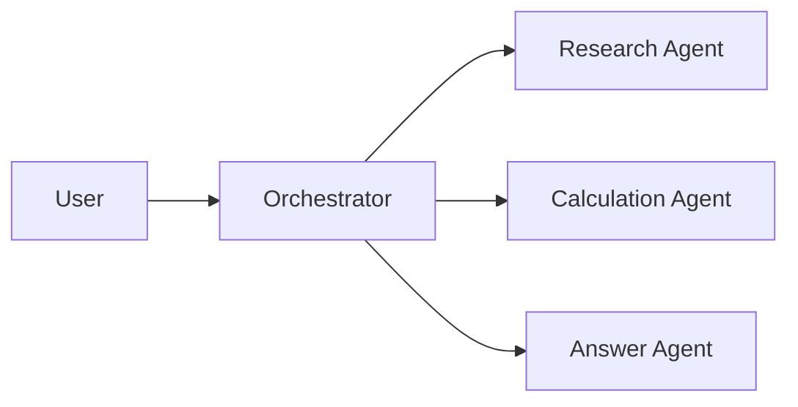

# PythonではじめるAI Agent開発

Python初心者向けのAI Agentハンズオン教材です。

## この教材で学べること

- PythonによるLLM API呼び出し
- LangChain
- Tool Calling
- AI Agent
- LangGraph
- State / Node / Edge
- Multi Agent
- Orchestrator

## 最終的に作るもの

## 学習ロードマップ

1. Chapter 1  AI Agentとは
2. Chapter 2  VS Code環境構築
3. Chapter 3  LLMを呼んでみる
4. Chapter 4  Toolを作る
5. Chapter 5  Tool Calling
6. Chapter 6  Agent
7. Chapter 7  LangGraph
8. Chapter 8  Multi Agent
9. Chapter 9  Orchestrator
