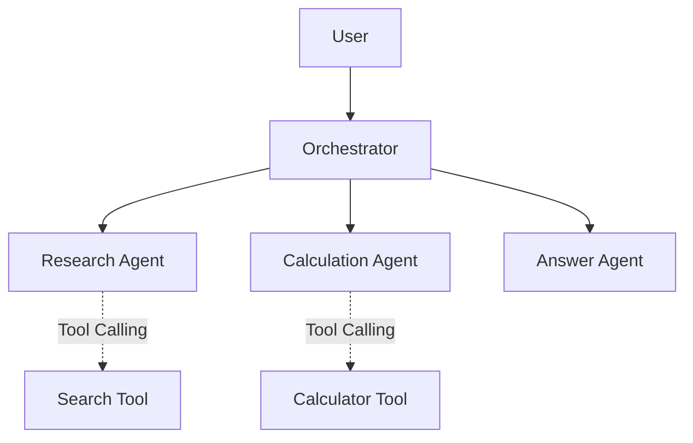

# PythonではじめるAI Agent開発

Python初心者が、AI Agentの基本概念を順番に学びながら、最終的に複数のAgentが協調する構成を作るハンズオン教材です。

## 対象読者

Python初心者〜初級者を対象としています。

## 前提知識

基本的なPC操作と、プログラミングの初歩的な考え方を想定しています。PythonやAI Agentの専門知識は必要ありません。

## 学習ロードマップ

1. [Chapter 1: AI Agentとは何か](docs/01_introduction.md)
2. [Chapter 2: VS Code / GitHub Codespacesのセットアップ](docs/02_setup.md)
3. [Chapter 3: PythonからLLMを呼び出す](docs/03_llm.md) ([コード](examples/chapter03_llm/README.md))
4. [Chapter 4: Toolを作る](docs/04_tool.md) ([コード](examples/chapter04_tool/README.md))
5. [Chapter 5: Tool Callingを理解する](docs/05_tool_calling.md) ([コード](examples/chapter05_tool_calling/README.md))
6. [Chapter 6: 単一Agentを作る](docs/06_agent.md) ([コード](examples/chapter06_agent/README.md))
7. [Chapter 7: LangGraphを使う](docs/07_langgraph.md) ([コード](examples/chapter07_langgraph/README.md))
8. [Chapter 8: Multi Agent構成を作る](docs/08_multi_agent.md) ([コード](examples/chapter08_multi_agent/README.md))
9. [Chapter 9: Orchestrator構成を作る](docs/09_orchestrator.md) ([コード](examples/chapter09_orchestrator/README.md))

学習は **LLM → Tool → Tool Calling → Agent → LangGraph → Multi Agent → Orchestrator** の順に進めます。ライブラリ固有APIの暗記ではなく、各段階で必要になる基本概念を理解することを重視します。

## 最終的に作成するAI Agent



## セットアップ

```bash
python -m venv .venv
source .venv/bin/activate
pip install -r requirements.txt
cp .env.example .env
```

Windowsでは仮想環境の有効化に `.venv\\Scripts\\activate` を使用してください。APIキーなどの値は `.env` に設定し、このファイルを共有・コミットしないでください。
