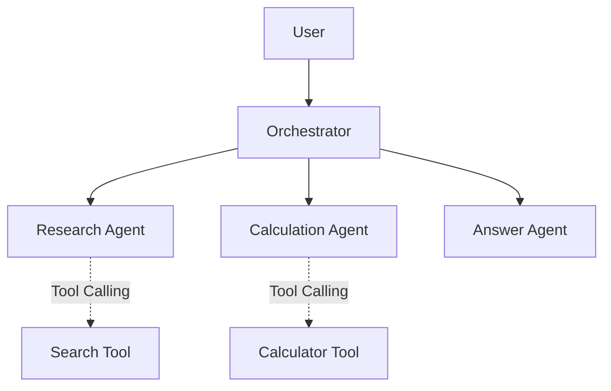

# PythonではじめるAI Agent開発

Python初心者が、AI Agentの基本概念を順番に学びながら、最終的に複数のAgentが協調する構成を作るハンズオン教材です。

## 対象読者

Python初心者〜初級者を対象としています。

## 前提知識

基本的なPC操作と、プログラミングの初歩的な考え方を想定しています。PythonやAI Agentの専門知識は必要ありません。

## この教材の進め方

この教材は、Markdownを読むだけではなく、**説明を読む → 自分でコードを書く → 実行する → 必要に応じてサンプルと比較する**という流れで進めるハンズオン教材です。

```text
Chapterの説明を読む
        ↓
自分でコードを書く
        ↓
実行して結果を確認する
        ↓
分からなければexamples/と比較する
        ↓
演習の確認ポイントを満たしたら次のChapterへ
```

初めて学習する場合は、[Chapter 1: AI Agentとは何か](docs/01_introduction.md) から順番に進めてください。完成コードを先に確認したい場合は `examples/` を参照できますが、まず自分で書いて動かすことを推奨します。

## 学習ロードマップ

| Chapter | テーマ | このChapterのゴール |
| --- | --- | --- |
| [Chapter 1](docs/01_introduction.md) | AI Agentとは何か | LLM・Tool・Agent・Orchestratorの関係を説明できる |
| [Chapter 2](docs/02_setup.md) | 開発環境 | Pythonの仮想環境を作り、教材を実行できる |
| [Chapter 3](docs/03_llm.md) | LLM | PythonからLLMを呼び出せる |
| [Chapter 4](docs/04_tool.md) | Tool | Python関数をToolとして定義できる |
| [Chapter 5](docs/05_tool_calling.md) | Tool Calling | LLMが選んだToolを実行し、結果をLLMへ返せる |
| [Chapter 6](docs/06_agent.md) | 単一Agent | LLMとToolをAgentとして動かせる |
| [Chapter 7](docs/07_langgraph.md) | LangGraph | State・Node・Edge・Graphを説明し、処理フローを作れる |
| [Chapter 8](docs/08_multi_agent.md) | Multi Agent | 処理を役割ごとのAgentへ分割し、Stateで連携できる |
| [Chapter 9](docs/09_orchestrator.md) | Orchestrator | 必要なAgentを動的に選択する構成を作れる |

Chapter 3以降には完成コードも用意しています。

| Chapter | サンプルコード |
| --- | --- |
| Chapter 3 | [examples/chapter03_llm](examples/chapter03_llm/README.md) |
| Chapter 4 | [examples/chapter04_tool](examples/chapter04_tool/README.md) |
| Chapter 5 | [examples/chapter05_tool_calling](examples/chapter05_tool_calling/README.md) |
| Chapter 6 | [examples/chapter06_agent](examples/chapter06_agent/README.md) |
| Chapter 7 | [examples/chapter07_langgraph](examples/chapter07_langgraph/README.md) |
| Chapter 8 | [examples/chapter08_multi_agent](examples/chapter08_multi_agent/README.md) |
| Chapter 9 | [examples/chapter09_orchestrator](examples/chapter09_orchestrator/README.md) |

学習は **LLM → Tool → Tool Calling → Agent → LangGraph → Multi Agent → Orchestrator** の順に進めます。ライブラリ固有APIの暗記ではなく、各段階で必要になる基本概念を理解することを重視します。

## 用語表

この教材では、次の用語を以下の意味で統一して使います。

| 用語 | この教材での意味 |
| --- | --- |
| LLM | 入力を受け取り、文章生成やTool選択などの判断を行うモデル |
| Tool | 計算・検索・API呼び出しなど、プログラムとして実行する機能 |
| Tool Calling | LLMが利用するToolと引数を選ぶ仕組み |
| Agent | LLMがTool等を利用しながら、目的達成まで判断と実行を進める仕組み |
| Single Agent | 1つのAgentが処理を担当する構成。本教材では「単一Agent」と表記 |
| Multi Agent | 複数のAgentまたはAgent役に責務を分けて協調する構成 |
| Orchestrator | 次にどのAgentへ仕事を任せるかを判断し、全体の処理を制御する役割 |
| State | LangGraph上でNode間に共有する処理中のデータ |
| Node | LangGraph上の1つの処理単位 |
| Edge | Nodeから次のNodeへ進む経路 |

「AI Agent」は教材全体を指す一般的な表現として使い、実装上の構成要素を説明するときは原則として「Agent」と表記します。

---

## 最終的に作成するAI Agent



## セットアップ

```bash
python -m venv .venv
source .venv/bin/activate
pip install -r requirements.txt
cp .env.example .env
```

Windowsでは仮想環境の有効化に `.venv\\Scripts\\activate` を使用してください。APIキーなどの値は `.env` に設定し、このファイルを共有・コミットしないでください。

## サンプルコードの実行

サンプルコードは、すべて**リポジトリのルートディレクトリから**実行します。例えばChapter 3は次のように実行します。

```bash
python examples/chapter03_llm/main.py
```

各 `examples/chapterXX_*` ディレクトリのREADMEにも同じ実行方法を記載しています。

## サンプルコードのテスト

リポジトリのルートで、次のコマンドを実行します。

```bash
python -m unittest discover -s tests -v
```

Chapter 3〜9のPython構文、Chapter 4のTool定義重複、Chapter 5の分岐・繰り返し構造、教材内の参照パスとモデル名を検証します。依存ライブラリがインストールされている場合、API通信を行わないChapter 7・8のサンプルも実行します。Chapter 3・5・6・9のLLM APIを使う実行テストは含まれません（APIキーと課金が必要なため）。
