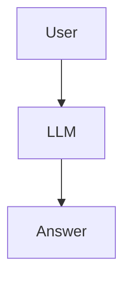
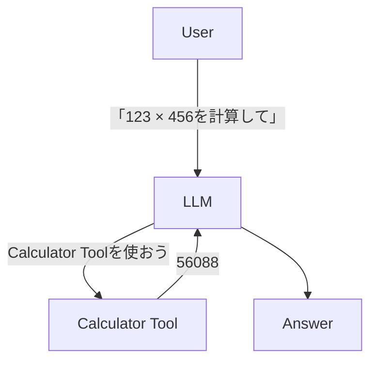
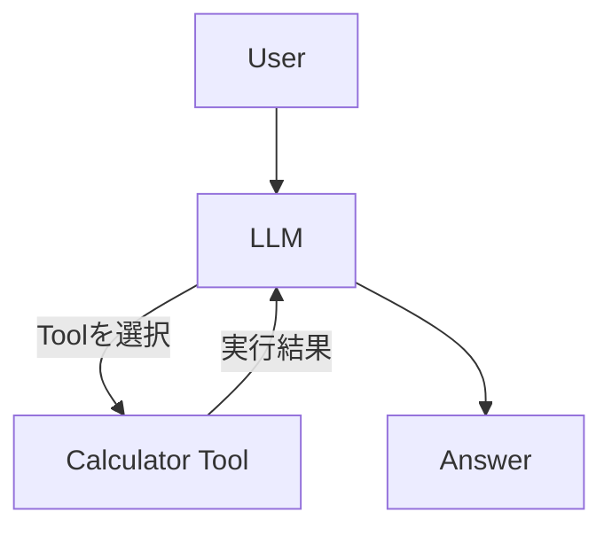
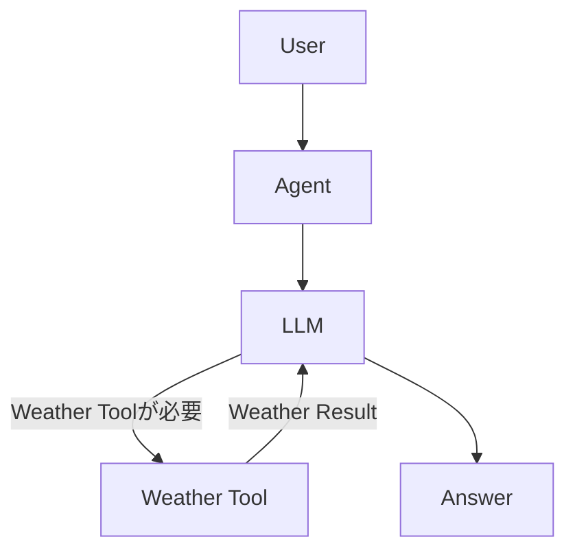
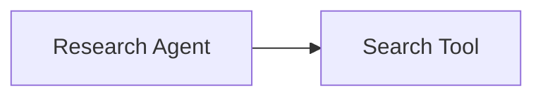
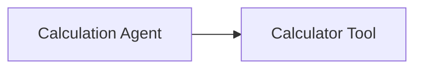
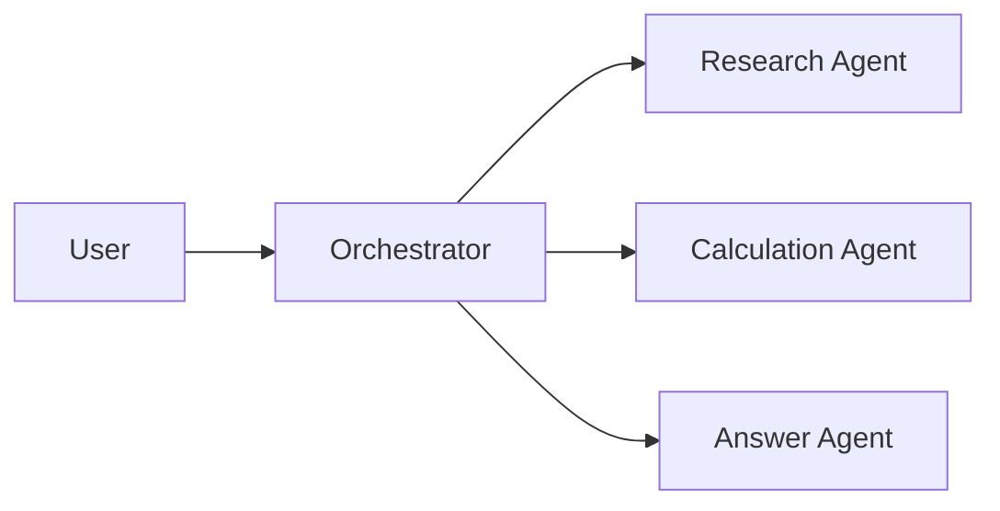
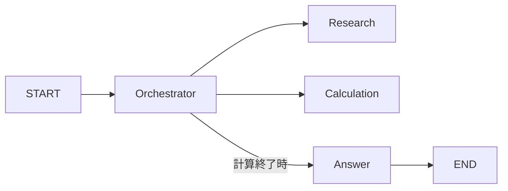
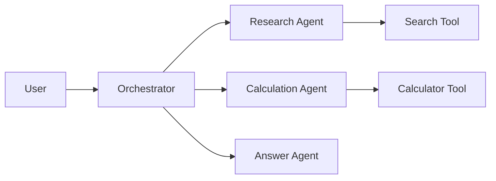

# Chapter 1: AI Agentとは何か

## この章で学ぶこと

この章では、AI Agentを実際に作り始める前に、AI Agentの基本的な考え方を学びます。

この章を読み終えると、以下について説明できるようになることを目標とします。

- LLMとAI Agentの違い
- AI Agentにおける「Tool」の役割
- Tool Callingとは何か
- AI Agentがどのように処理を進めるのか
- 複数のAgentを利用する考え方
- Orchestratorの役割
- この教材で学ぶ順序と最終目標

この章ではまだPythonコードは書きません。

まずは「AI Agentとは何なのか」を理解してから、次の章以降で実際にAI Agentを作っていきます。

---

## 1. LLMとは

ChatGPTをはじめとする生成AIの中心では、LLM（Large Language Model：大規模言語モデル）が利用されています。

LLMは、入力された文章をもとに回答などのテキストを生成できます。
例えば、ユーザーが次のように質問したとします。

> Pythonとは何ですか？

LLMは質問を受け取り、回答を生成します。



このような、

>「入力を受け取る → LLMが処理する → 回答する」

というシンプルな構成が、LLMを利用したアプリケーションの基本形です。


## 2. LLMだけではできないこと

LLMは非常に多くの知識を持っています。
しかし、LLMだけですべての処理ができるわけではありません。

例えば、次のような処理を考えてみましょう。

> 今日の東京の天気を調べてください。

「今日の天気」のようなリアルタイム情報を取得するには、外部の天気APIなどから情報を取得する必要があります。

ほかにも、

>- Webから最新情報を検索する
>- データベースから情報を取得する
>- 正確な計算を行う
>- ファイルを読み込む
>- 外部APIを呼び出す

といった処理では、LLM以外の仕組みが必要になります。
そこで登場するのが Tool です。


## 3. Toolとは

Toolとは、AI Agentが利用できる「外部機能」です。

例えば、次のようなToolを用意できます。

| Tool | 役割 |
| --- | --- |
| Weather Tool | 天気を取得する |
| Search Tool | Webを検索する |
| Calculator Tool | 計算する |
| Database Tool | データベースを検索する |


Toolの実体は、Pythonで作成した関数や外部APIを呼び出す処理などです。
例えばCalculator Toolがある場合、計算処理をToolに任せることができます。


このようにLLMと外部機能を組み合わせることで、LLM単体よりも幅広い処理が可能になります。

## 4. Tool Callingとは
LLMがToolを利用する仕組みを Tool Calling と呼びます。
Tool Callingで重要なのは、

> どのToolを、どのような引数で呼び出すかをLLMが判断する

という点です。
例えば、次の3つのToolが利用できるとします。
- weather
- calculator
- search

ユーザーが、

> 123 × 456を計算してください。

と質問した場合、LLMは質問内容から、

> calculatorを利用する

と判断します。
そして必要な値をToolへ渡します。



LLMが単に文章を生成するだけではなく、状況に応じて外部機能を選択して利用できることが重要です。
このTool Callingは、AI Agentを理解するうえで非常に重要な仕組みです。

## 5. AI Agentとは

ここまでで、次の3つの要素が登場しました。

1. LLM
2. Tool
3. Tool Calling

これらを組み合わせることで、AI Agentを作ることができます。
本教材では、AI Agentを次のように捉えます。

> AI Agentとは、LLMを利用して状況を判断し、必要に応じてToolなどを利用しながら処理を進めるシステムです。

例えば、ユーザーが次の質問をしたとします。

> 東京の今日の天気を調べてください。

Agentは質問を受け取って、次のように処理します。
1. 天気情報が必要だと判断する
2. Weather Toolを選択する
3. Weather Toolを実行する
4. Toolの結果を受け取る
5. 結果をもとに回答を生成する



## 6. Agentを複数に分ける

AI Agentが担当する仕事が増えてくると、1つのAgentですべてを処理する構成は複雑になっていきます。
例えば、1つのAgentに、

- Web検索
- 計算
- データ分析
- 回答作成
- 旅行プラン作成

など、すべての役割を担当させることもできます。
しかし、システムが大きくなるほどAgentの責務も大きくなります。
そこで、役割ごとにAgentを分割する方法があります。

### Research Agent
情報収集を担当します。



### Calculation Agent
計算処理を担当します。



### Answer Agent
各Agentから得られた情報をもとに、最終回答を作成します。
このように複数のAgentが役割を分担して処理する構成を、本教材では Multi Agent構成 として学習します。

## 7. Orchestratorとは
複数のAgentを作ると、新しい問題が発生します。

> どのAgentに仕事を依頼するのか？

という問題です。
そこで登場するのが Orchestrator です。
Orchestratorは、ユーザーからの依頼を確認し、どのAgentに処理を任せるのかを判断します。



例えばユーザーから、

> 最新の情報を調べてください。

という依頼が来た場合は、Research Agentへ処理を依頼します。
一方、

> 商品の合計金額を計算してください。

という依頼であれば、Calculation Agentへ処理を依頼します。
Orchestrator自身がすべての処理を行うのではありません。
**「誰に仕事を任せるかを判断し、全体の処理を制御する」**
ことがOrchestratorの重要な役割です。

## 8. LangChainとLangGraph
この教材では、AI Agentを実装するために主に LangChain と LangGraph を利用します。

### 8.1 LangChain
LangChainは、LLMを利用したアプリケーションを開発するためのライブラリです。
本教材では主に、
- LLMの呼び出し
- Toolの定義
- Tool Calling
などを実装するために利用します。

### 8.2 LangGraph
LangGraphは、Agentの処理フローをGraphとして構築するためのライブラリです。
例えば、次のような処理フローを構築できます。



LangGraphを学ぶ際には、主に次の概念が登場します。

- **State**：処理中の情報を保持する
- **Node**：それぞれの処理を実行する
- **Edge**：Node同士を接続する
- **Graph**：処理全体の流れを表現する

これらについては後のChapterで、実際にコードを書きながら学習します。


## 9. この教材で作るAI Agent

この教材では、最初から複雑なAI Agentを作ることはしません。
まずLLMを1回呼び出すところから始めます。
そこから少しずつ機能を追加します。

```text
LLM
 ↓
Tool
 ↓
Tool Calling
 ↓
Agent
 ↓
LangGraph
 ↓
Multi Agent
 ↓
Orchestrator
```

最終的には、次のようなAI Agentシステムを作成します。



ここまで作ることで、次のAI Agent開発の基本概念を一通り体験します。

- LLM
- Tool
- Tool Calling
- Agent
- State
- Node
- Edge
- Graph
- Multi Agent
- Orchestrator

## 10. 学習ロードマップ

この教材は、以下の順番で進めます。

| Chapter |	内容 |
| --- | --- |
| Chapter 1 |	AI Agentとは何か |
| Chapter 2 |	開発環境を作る |
| Chapter 3 |	PythonからLLMを呼び出す |
| Chapter 4 |	Toolを作る |
| Chapter 5 |	Tool Callingを使う |
| Chapter 6 |	Agentを作る |
| Chapter 7 |	LangGraphを使う |
| Chapter 8 |	Multi Agentを作る |
| Chapter 9 |	Orchestratorを作る |

各Chapterでは、新しい概念を1つずつ追加します。
分からなくなった場合は、現在扱っているコードが次のどこに位置しているのかを確認してください。

```text
LLM
 ↓
Tool
 ↓
Tool Calling
 ↓
Agent
 ↓
LangGraph
 ↓
Multi Agent
 ↓
Orchestrator
```

## 11. まとめ

この章では、AI Agentを構成する基本的な考え方を学びました。
通常のLLMアプリケーションは、

```text
User → LLM → Answer
```

というシンプルな構成です。
そこにTool Callingを追加すると、

```text
User
 ↓
LLM
 ↓
Tool
 ↓
LLM
 ↓
Answer
```

という構成になります。
さらに複数のAgentを組み合わせることで、

```text
User
 ↓
Orchestrator
 ↓
各Agent
 ↓
Tool
 ↓
Answer
```

というシステムへ発展させることができます。
この教材では、この構造を一気に作るのではなく、

**LLM → Tool → Tool Calling → Agent → LangGraph → Multi Agent → Orchestrator**

という順番で、1つずつ実際に動かしながら学習していきます。

## 次のChapter

次のChapterでは、実際にAI Agentを開発するための環境を準備します。

### Chapter 2：開発環境を作る

VS Code、Python、仮想環境を準備し、AI Agentを実装するための開発環境を構築していきます。