# Chapter 6: 単一Agentを作る

## 前のChapterの限界と今回の解決

Chapter 5では、LLMがToolを選ぶTool Callingを実装しました。しかし、Tool Callの確認、Toolの実行、結果の返却、再判断という制御をPython側で1つずつ書いていました。処理が増えるほど、この制御は複雑になります。

```text
Chapter 5
Tool Callingを手動で制御
        ↓
判断と実行を繰り返すコードが複雑になる
        ↓
Chapter 6
Agentに実行ループを任せる
```

このChapterでは、LLM・Tool・実行制御をAgentとしてまとめます。

---

## この章で学ぶこと

この章では、これまで学んだ **LLM・Tool・Tool Calling** を組み合わせて、1つのAgentを作ります。

この章を読み終えると、以下のことができるようになります。

- LLM・Tool・実行制御を組み合わせたAgentの仕組みを理解する
- Agentがどのように処理を進めるのか説明できる
- Tool CallingとAgentの違いを理解する
- AgentがToolを繰り返し利用する理由を理解する

---

## 1. ここまで作ってきたもの

ここまでのChapterでは、AI Agentを構成する部品を1つずつ作ってきました。

| Chapter | 学んだこと |
| --- | --- |
| Chapter 3 | LLMを呼び出す |
| Chapter 4 | Toolを作る |
| Chapter 5 | LLMからToolを選択する |
| Chapter 6 | **これらをAgentとして組み合わせる** |

ここまでの流れを図にすると、次のようになります。

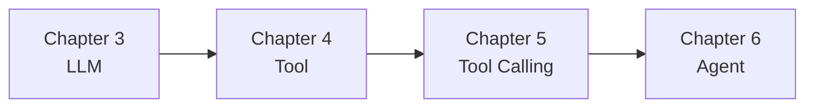

Chapter 6では、新しい部品を大量に追加するわけではありません。

これまで作った、

```text
LLM
+
Tool
+
Tool Calling
+
実行制御
```

を組み合わせます。

---

# 2. Chapter 5では何が足りなかったのか

Chapter 5では、LLMがToolを選択できるようになりました。

例えば、

```text
10と20を足してください。
```

という入力に対して、LLMは、

```text
Tool
add

Arguments
a = 10
b = 20
```

というTool Callを生成できました。

しかし、その後の処理はPythonコードで制御していました。

```text
LLMへ質問
   │
   ▼
Tool Callがある？
   │
   ▼
Toolを探す
   │
   ▼
Toolを実行
   │
   ▼
結果をLLMへ戻す
   │
   ▼
最終回答
```

つまり、**LLMは判断していましたが、処理全体を進める仕組みは自分たちで書いていました。**

---

# 3. もう少し複雑な質問を考える

例えば、ユーザーから次の質問が来たとします。

```text
10と20を足して、その結果に3を掛けてください。
```

この処理では、Toolを1回呼ぶだけでは終わりません。

まず、

```text
10 + 20
```

を計算します。

結果は、

```text
30
```

です。

さらに、

```text
30 × 3
```

を計算します。

結果は、

```text
90
```

です。

処理全体は次のようになります。

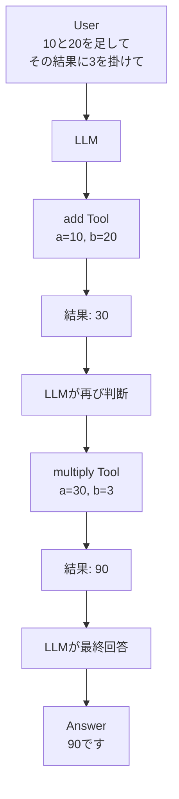

ここで重要なのは、

> **Toolを実行したあと、LLMがもう一度考えている**

という点です。

---

# 4. Agentとは

この教材では、Agentを次のように考えます。

> **Agentとは、LLMを使って次に必要な処理を判断し、必要に応じてToolを利用しながら目的達成まで処理を進める仕組みです。**

Agentの内部には、これまで学んだ要素があります。

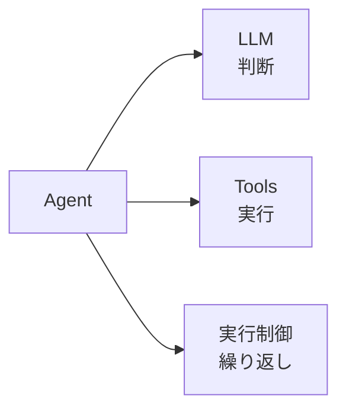

それぞれの役割を整理すると、次のようになります。

| 要素 | 役割 |
| --- | --- |
| LLM | 次に何をするか判断する |
| Tool | 実際の処理を実行する |
| 実行制御 | 判断と実行を繰り返す |
| Agent | これらを組み合わせて目的達成まで処理する |

一言で表すと、

```text
LLM   = 考える

Tool  = 実行する

Agent = 考えながら処理を進める
```

と考えると分かりやすくなります。

---

# 5. Tool CallingとAgentの違い

Chapter 5との違いを整理しましょう。

## Tool Calling

Tool Callingでは、LLMが、

```text
どのToolを使う？

どんな引数を渡す？
```

を判断します。

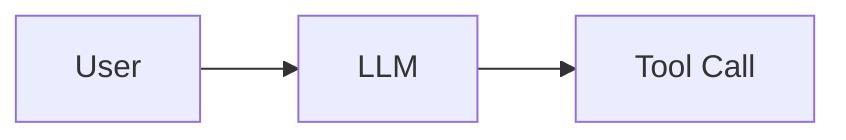

つまり、**1回の判断**に注目しています。

---

## Agent

Agentでは、

```text
次に何をする？
        ↓
Toolを使う
        ↓
結果を見る
        ↓
次に何をする？
        ↓
...
```

という処理を繰り返します。

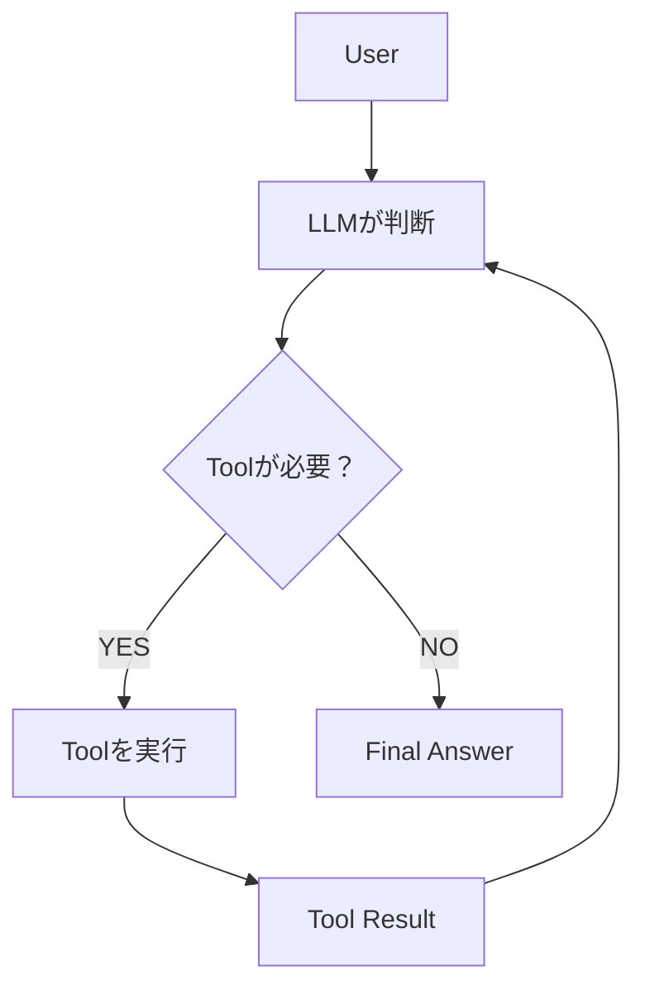

この**判断 → 実行 → 結果確認 → 再判断**のループが、Agentを理解する重要なポイントです。

---

# 6. Agentの基本ループ

Agentの処理をさらにシンプルにすると、次の4ステップになります。

```text
① 考える
   ↓
② Toolを選ぶ
   ↓
③ Toolを実行する
   ↓
④ 結果を見てもう一度考える
```

必要であれば、この処理を繰り返します。

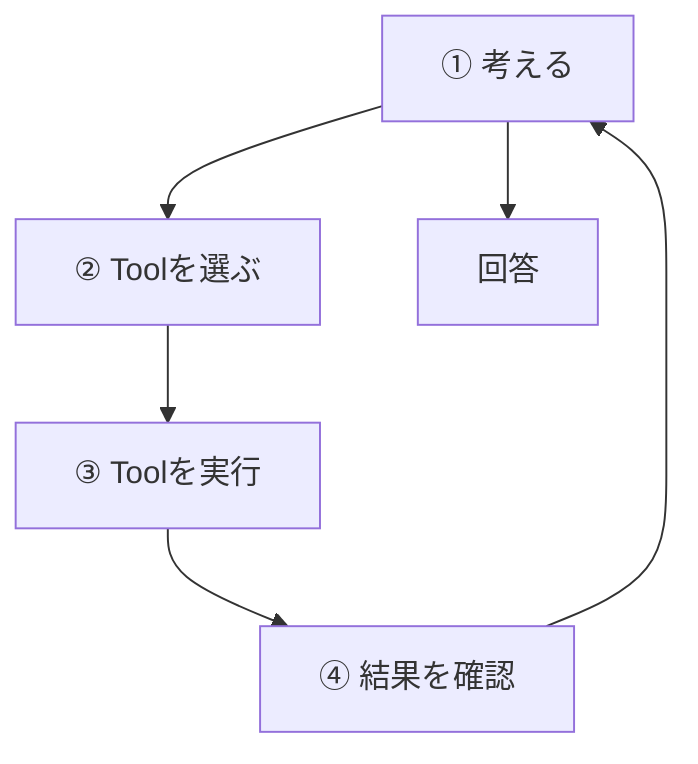

Agentは、最終的な回答ができるまでこのループを進めます。

> **Agent = LLMがToolの結果を見ながら、次の行動を決め続ける仕組み**

まずは、このイメージを持っておきましょう。

---

# 7. 単一Agentを作る

それでは、実際にAgentを作ってみましょう。

Chapter 6では次のディレクトリを使用します。

```text
examples/
└── chapter06_agent/
    ├── README.md
    ├── main.py
    └── tools.py
```

Chapter 5で作ったToolを引き続き利用します。

`tools.py`

```python
from langchain_core.tools import tool


@tool
def add(a: int, b: int) -> int:
    """2つの整数を足し算します。"""
    return a + b


@tool
def multiply(a: int, b: int) -> int:
    """2つの整数を掛け算します。"""
    return a * b
```

Toolの作り方はChapter 4で学習済みなので、ここでは詳しく説明しません。

---

# 8. Agentを作成する

`main.py`を作成します。

まず、必要なライブラリとToolを読み込みます。

```python
from dotenv import load_dotenv
from langchain.agents import create_agent
from langchain_openai import ChatOpenAI

from tools import add, multiply


load_dotenv()
```

LLMを準備します。

```python
llm = ChatOpenAI(
    model="gpt-5.5"
)
```

Agentが利用できるToolを準備します。

```python
tools = [
    add,
    multiply
]
```

そしてAgentを作成します。

```python
agent = create_agent(
    model=llm,
    tools=tools
)
```

これで、

```text
LLM
+
add Tool
+
multiply Tool
+
実行制御
```

を持つAgentができました。

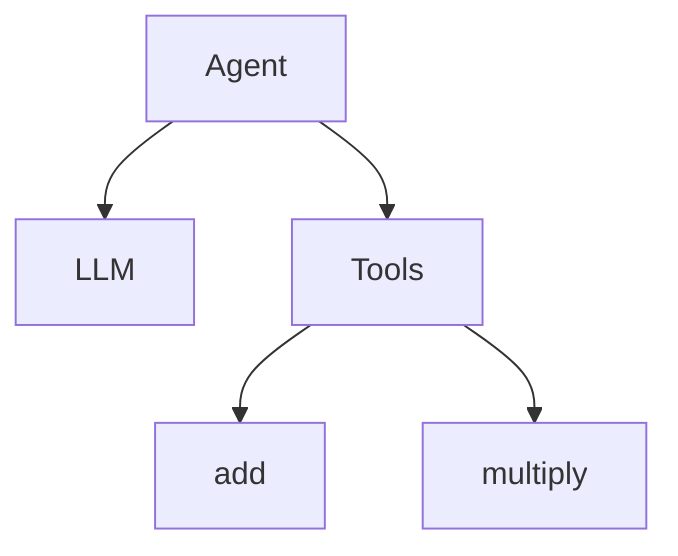

---

# 9. Agentを実行する

作成したAgentへ質問を渡します。

```python
result = agent.invoke(
    {
        "messages": [
            {
                "role": "user",
                "content": "10と20を足して、その結果に3を掛けてください。"
            }
        ]
    }
)
```

回答を確認します。

```python
print(result["messages"][-1].content)
```

例えば、

```text
90です。
```

のような回答が返ってきます。

---

# 10. Agent内部では何が起きているのか

コードだけを見ると、

```python
agent.invoke(...)
```

を1回実行しただけです。

しかし、Agent内部では複数の処理が行われます。

今回の質問：

```text
10と20を足して、その結果に3を掛けてください。
```

の場合、概念的には次のような処理になります。

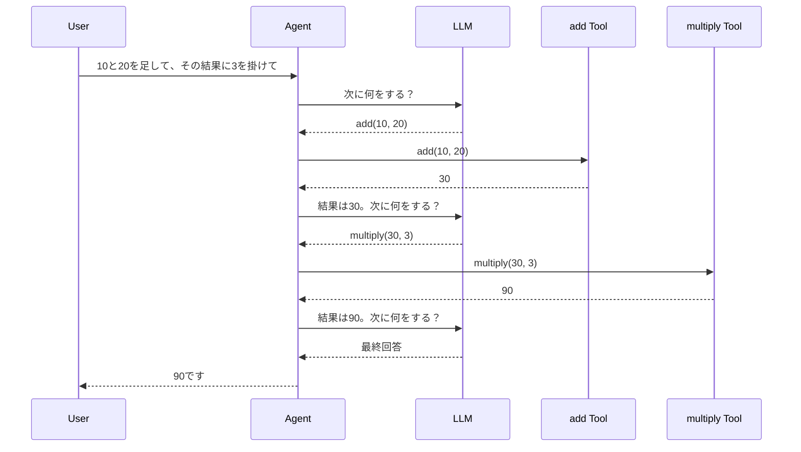

Chapter 5では、この処理を自分たちで制御していました。

Chapter 6では、この実行制御をAgentに任せています。

---

# 11. Chapter 5とコードを比較する

違いを整理してみましょう。

## Chapter 5

自分たちで、

```text
Tool Callを取得
      ↓
Toolを探す
      ↓
Toolを実行
      ↓
ToolMessageを作る
      ↓
LLMへ戻す
```

という処理を書きました。

イメージすると、

```python
if response.tool_calls:
    ...

selected_tool = ...

tool_result = selected_tool.invoke(...)

messages.append(...)

final_response = llm_with_tools.invoke(...)
```

のような制御です。

---

## Chapter 6

Agentを利用すると、

```python
result = agent.invoke(...)
```

という形で処理を開始できます。

Agent側が、

```text
LLMで判断
   ↓
Tool実行
   ↓
結果をLLMへ返す
   ↓
再判断
```

という流れを管理します。

---

## 違いを表で整理する

| | Chapter 5 | Chapter 6 |
| --- | --- | --- |
| LLM | ○ | ○ |
| Tool | ○ | ○ |
| Tool Calling | ○ | ○ |
| Tool実行 | 自分で制御 | Agentが制御 |
| 再判断 | 自分で制御 | Agentが制御 |
| 複数回のTool利用 | 実装が必要 | Agentが処理 |
| 主な目的 | Tool Callingを理解 | Agentを理解 |

つまり、

> **Chapter 5で仕組みを理解し、Chapter 6でその仕組みをAgentとしてまとめる**

という関係です。

---

# 12. なぜAgentが必要なのか

Toolが1回しか必要ない処理なら、Chapter 5の方法でも十分です。

例えば、

```text
10と20を足してください。
```

なら、

```text
LLM
 ↓
add
 ↓
30
 ↓
LLM
 ↓
Answer
```

だけで終わります。

しかし、処理が複雑になると状況が変わります。

```text
Aを調べる
   ↓
結果によってBを実行
   ↓
Bの結果によってCを実行
   ↓
必要ならもう一度検索
   ↓
回答
```

このような処理をすべて、

```python
if ...
    if ...
        if ...
```

のように人間が制御するのは大変です。

そこで、

```text
「次に何をすればよいか」
```

をLLMに判断させながら処理を進めます。

これがAgentを利用する大きな理由です。

---

# 13. Agentは何でも自由に動くわけではない

ここで1つ注意があります。

Agentは、

> 勝手に何でもできるAI

ではありません。

Agentが利用できる機能は、基本的に**与えられたToolの範囲**です。

今回なら、

```text
Agent
 │
 ├── add
 │
 └── multiply
```

しか持っていません。

例えば、

```text
東京の現在の天気を調べてください。
```

と依頼されても、

```text
Weather Tool
```

を与えていないため、天気を取得する機能はありません。

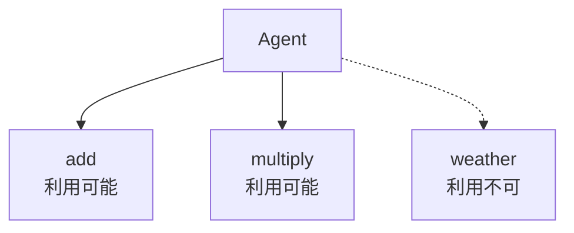

Agentに何をさせられるかは、

> **どのToolを与えるか**

によって決まります。

これはAgentを設計するときに非常に重要です。

---

# 14. 単一Agentとは

今回作ったAgentは**単一Agent**です。

```text
User
 │
 ▼
Agent
 │
 ├── LLM
 │
 ├── add
 │
 └── multiply
 │
 ▼
Answer
```

1つのAgentが、

- ユーザーの依頼を理解する
- Toolを選択する
- Toolを実行する
- 結果を確認する
- 最終回答を生成する

という役割を担当します。

シンプルなシステムであれば、単一Agentだけでも十分なケースがあります。

---

# 15. AgentにToolを追加してみる

Chapter 4の演習で作った`subtract`を追加してみましょう。

`tools.py`

```python
@tool
def subtract(a: int, b: int) -> int:
    """2つの整数を引き算します。"""
    return a - b
```

Agentへ追加します。

```python
tools = [
    add,
    multiply,
    subtract
]
```

これでAgentができることが増えます。

```text
Agent
 │
 ├── add
 ├── multiply
 └── subtract
```

質問してみましょう。

```text
100から30を引いて、その結果に2を掛けてください。
```

期待する処理は、

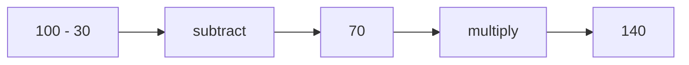

です。

AgentがどのToolを選択するか確認してみましょう。

---

# 16. 演習

## 演習1：単純なTool Calling

Agentへ次の質問をしてください。

```text
30と15を足してください。
```

Agentが`add`を利用して回答できることを確認してください。

---

## 演習2：複数回Toolを利用する

次の質問をしてください。

```text
10と20を足して、その結果に3を掛けてください。
```

期待する処理：

```text
10 + 20
   ↓
  30
   ↓
30 × 3
   ↓
  90
```

Agentが複数回Toolを利用して回答できることを確認してください。

---

## 演習3：Toolを追加する

次のToolを追加してください。

```text
Tool名
subtract

処理
a - b
```

その後、

```text
100から30を引いて、その結果に2を掛けてください。
```

と質問してください。

期待する結果：

```text
140
```

---

## 演習4：Toolが不要な質問

次の質問をしてください。

```text
こんにちは。
```

Agentが計算Toolを利用せず、そのまま回答できるか確認してください。

---

### 演習の確認ポイント

次を確認できれば、このChapterの演習は完了です。

- 単純な計算依頼をAgentがToolを利用して処理できる
- `10 + 20` の結果に3を掛けるような複数段階の処理を完了できる
- 新しい `subtract` ToolをAgentへ追加できる
- Toolが不要な依頼では計算Toolを使わず回答できる
- Chapter 5では自分で書いていた実行ループをAgentが管理していると説明できる


# 17. Agentを理解するための重要な3つのポイント

ここまで少しコードが増えたので、一度整理します。

覚えてほしいのは3つだけです。

### ① LLMが判断する

```text
次に何をする？
```

をLLMが判断します。

### ② Toolが実行する

```text
計算する
検索する
APIを呼ぶ
```

などの具体的な処理をToolが担当します。

### ③ Agentが繰り返しを管理する

```text
判断
 ↓
実行
 ↓
結果
 ↓
再判断
```

をAgentが管理します。

まとめると、

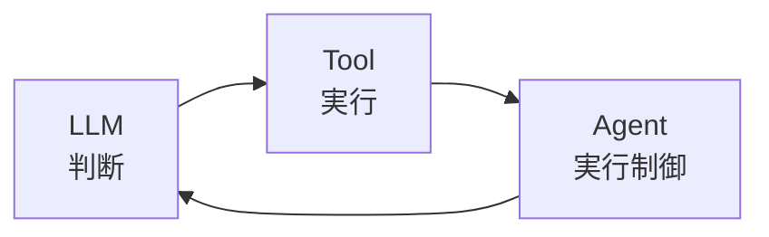

と考えることができます。

---

# 18. このChapterで作ったもの

今回作成した構成は次の通りです。

```text
ai-agent-tutorial/
│
├── docs/
│   └── 06_agent.md
│
└── examples/
    └── chapter06_agent/
        ├── README.md
        ├── main.py
        └── tools.py
```

`main.py`の基本形は次のようになります。

```python
from dotenv import load_dotenv
from langchain.agents import create_agent
from langchain_openai import ChatOpenAI

from tools import add, multiply


load_dotenv()


llm = ChatOpenAI(
    model="gpt-5.5"
)


tools = [
    add,
    multiply
]


agent = create_agent(
    model=llm,
    tools=tools
)


result = agent.invoke(
    {
        "messages": [
            {
                "role": "user",
                "content": "10と20を足して、その結果に3を掛けてください。"
            }
        ]
    }
)


print(result["messages"][-1].content)
```

---

# 19. ここまでの学習を整理する

Chapter 3からChapter 6までを整理しましょう。

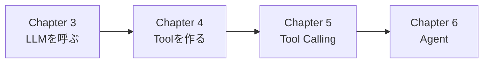

それぞれ一言で表すと、

| Chapter | 一言でいうと |
| --- | --- |
| Chapter 3 | LLMに質問する |
| Chapter 4 | LLMが使える機能を作る |
| Chapter 5 | LLMに機能を選ばせる |
| Chapter 6 | 判断と実行を繰り返す |

最終的に、次の構造まで進みました。

```text
User
 │
 ▼
Agent
 │
 ├── LLM
 │     │
 │     └── 次に何をするか判断
 │
 ├── Tool
 │     │
 │     └── 実際の処理を実行
 │
 └── 実行制御
       │
       └── 判断と実行を繰り返す
 │
 ▼
Answer
```

---

# 20. まとめ

このChapterでは、初めて**単一Agent**を作りました。

最も重要なのは、Agentを特別な魔法のような仕組みとして考えないことです。

Agentを分解すると、

```text
Agent
 │
 ├── LLM
 ├── Tool
 └── 実行制御
```

です。

そしてAgentは、

```text
考える
 ↓
Toolを使う
 ↓
結果を見る
 ↓
もう一度考える
 ↓
...
 ↓
回答する
```

という処理を進めます。

Chapter 5では、この制御を自分たちで実装しました。

Chapter 6では、**その制御をAgentに任せました。**

> **Agentとは、LLMがToolを利用しながら、目的達成まで判断と実行を進める仕組み**

まずは、この理解ができていれば十分です。

---

## 次のChapter

**Chapter 7：LangGraphでAgentの処理フローを作る**

ここまでAgent内部の処理を、

```text
判断
 ↓
Tool実行
 ↓
再判断
```

と説明してきました。

次のChapterでは、この処理の流れをより明示的に扱います。

そこで登場するのが **LangGraph** です。

LangGraphでは、主に次の概念を学びます。

```text
State
Node
Edge
Graph
```

例えば、今回のAgentの処理をGraphとして考えると、

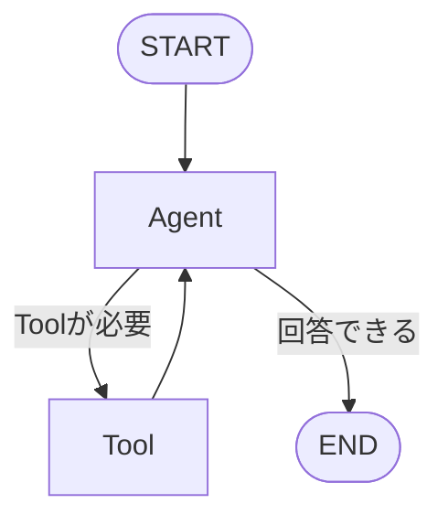

Chapter 6で学んだ、

```text
判断
 ↓
実行
 ↓
再判断
```

というAgentの基本ループを、Chapter 7では**Graphとして理解していきます。**