# Chapter 7: LangGraphを使う

## この章で学ぶこと

この章では、Agentの処理フローを **LangGraph** を使って表現します。

この章を読み終えると、以下のことができるようになります。

- LangGraphが何のためのライブラリなのか説明できる
- State、Node、Edge、Graphの基本概念を理解する
- 処理の流れをGraphとして考えられる
- Python関数をNodeとして登録できる
- Node同士をEdgeで接続できる
- Stateを使ってNode間でデータを受け渡せる
- 条件によって処理を分岐できる
- Chapter 6で作ったAgentの処理をGraphとして理解できる

---

## 1. Chapter 6のおさらい

Chapter 6では、単一Agentを作りました。

Agentは、

```text
考える
  ↓
Toolを使う
  ↓
結果を見る
  ↓
もう一度考える
  ↓
...
  ↓
回答する
```

という処理を行っていました。

図にすると次のようになります。

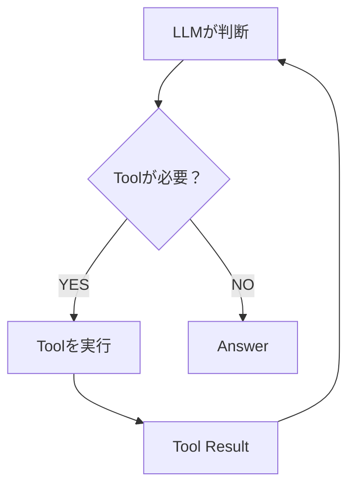

Chapter 6では、この処理をAgentに任せました。

Chapter 7では一歩進んで、

> **この処理フローそのものをGraphとして考える**

ことを学びます。

---

# 2. LangGraphとは

LangGraphは、LLMやAgentの処理を**Graph構造として構築するためのライブラリ**です。

例えば、

```text
入力
 ↓
LLM
 ↓
Tool
 ↓
LLM
 ↓
回答
```

という処理があるとします。

LangGraphでは、この処理を次のようなGraphとして表現できます。

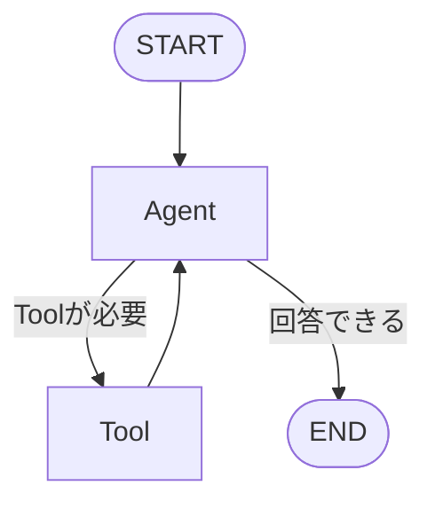

コードだけで処理を考えるのではなく、

> **どの処理から、どの処理へ進むのか**

をGraphとして設計します。

---

# 3. まず4つの言葉を覚える

LangGraphを理解するために、まず次の4つを覚えます。

| 用語 | 意味 |
| --- | --- |
| State | 処理中のデータ |
| Node | 処理 |
| Edge | Node同士のつながり |
| Graph | 処理全体の流れ |

最初は、これだけ覚えておけば十分です。

```text
State = データ

Node  = 処理

Edge  = 道

Graph = 全体
```

例えば、

```text
10と20を足してください
```

というデータを受け取って処理する場合を考えてみます。

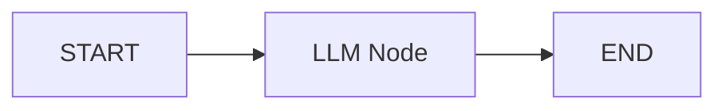

このとき、

```text
「10と20を足してください」
```

という情報を持っているのが **State** です。

LLMを呼び出す処理が **Node** です。

```text
START → LLM
LLM → END
```

という接続が **Edge** です。

そして、この処理全体が **Graph** です。

---

# 4. Graphとは

まず一番大きな概念であるGraphから見てみましょう。

Graphは、

> **処理全体の流れ**

を表します。

例えば、

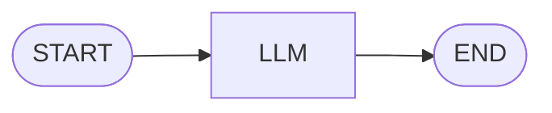

というGraphがあるとします。

処理は、

```text
START
  ↓
LLM
  ↓
END
```

という順番で進みます。

プログラムの処理フローを、図として表現したものだと考えると分かりやすいです。

---

# 5. Nodeとは

Nodeは、

> **Graphの中で実行される1つの処理**

です。

例えば、

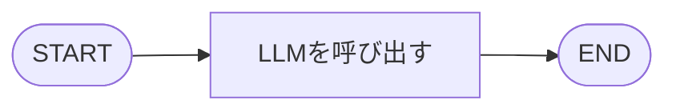

この、

```text
LLMを呼び出す
```

部分がNodeです。

LangGraphでは、Python関数をNodeとして登録できます。

例えば、

```python
def hello_node(state):
    print("Hello LangGraph")

    return state
```

というPython関数があるとします。

この関数を、

```text
hello
```

というNodeとしてGraphへ登録できます。

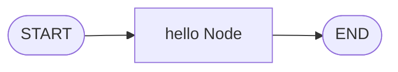

つまり、

```text
Python関数
    ↓
Node
```

と考えることができます。

---

# 6. Edgeとは

Edgeは、

> **Nodeから次のNodeへ進む道**

です。

例えば、

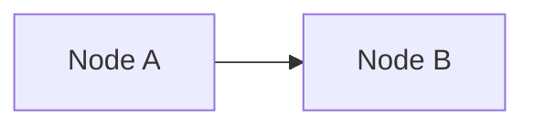

というGraphでは、

```text
Node A → Node B
```

というEdgeがあります。

もう少し具体的にすると、

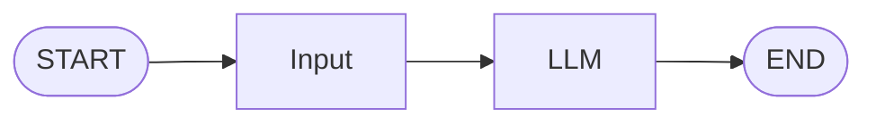

Edgeによって、

```text
START
  ↓
Input
  ↓
LLM
  ↓
END
```

という実行順序が決まります。

---

# 7. Stateとは

Stateは、

> **Graphの処理中に保持しておくデータ**

です。

例えば、

```text
User
 │
 │ 「10と20を足してください」
 ▼
LLM
```

という処理では、

```text
「10と20を足してください」
```

というメッセージをどこかに保持しておく必要があります。

そこでStateを使います。

```text
State

messages:
  - "10と20を足してください"
```

NodeはStateを受け取り、処理します。

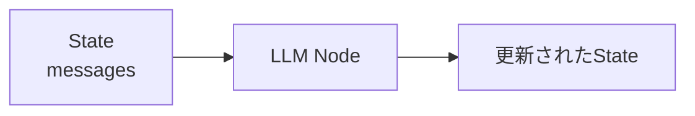

つまり、

```text
State
  ↓
Node
  ↓
Stateを更新
```

という流れです。

---

# 8. Stateは「共有ノート」と考える

Stateが少し分かりにくい場合は、**処理中にみんなで使う共有ノート**と考えてみましょう。

例えば、

```text
State

messages:
  User: 10と20を足してください
```

というStateがあります。

LLM NodeがこのStateを読みます。

```text
LLM Node

「ユーザーは10と20を足してほしいのか」
```

そしてLLMの結果をStateへ追加します。

```text
State

messages:
  User: 10と20を足してください
  AI: add Toolを使う
```

次のNodeは、このStateを見て処理できます。

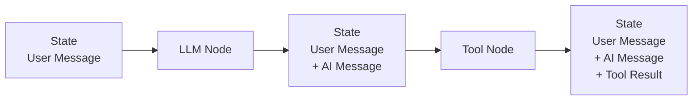

つまりStateは、

> **NodeからNodeへ情報を引き継ぐためのデータ**

でもあります。

---

# 9. 4つの概念を整理する

ここで一度整理しましょう。


このGraphに対して、

| 要素 | 役割 |
| --- | --- |
| State | Node間で利用するデータ |
| Node | 実際の処理 |
| Edge | 次に進むNodeをつなぐ |
| Graph | State・Node・Edgeを組み合わせた全体 |

と考えます。

さらにシンプルにすると、

```text
State = 何を持っている？

Node  = 何をする？

Edge  = 次はどこ？

Graph = 全体はどう流れる？
```

です。

---

# 10. 最初のLangGraphを作る

ここから実際にLangGraphを作ります。

Chapter 7では次の構成を使用します。

```text
chapters/
└── chapter07_langgraph/
    ├── README.md
    ├── main.py
    ├── graph.py
    └── state.py
```

最初はAgentやToolを使いません。

まず、

```text
START
  ↓
hello
  ↓
END
```

という非常に小さなGraphを作ります。

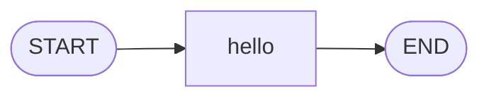

---

# 11. Stateを定義する

`state.py`を作成します。

```python
from typing import TypedDict


class AgentState(TypedDict):
    message: str
```

今回のStateは、

```text
message
```

というデータだけを持ちます。

```text
AgentState

└── message
```

例えば、

```python
{
    "message": "LangGraph"
}
```

というデータを保持できます。

---

# 12. Nodeを作る

次にNodeを作ります。

`graph.py`

```python
def hello_node(state):
    name = state["message"]

    return {
        "message": f"Hello {name}"
    }
```

このNodeは、

```text
State

message = "LangGraph"
```

を受け取り、

```text
State

message = "Hello LangGraph"
```

へ更新します。

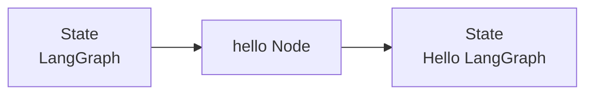

---

# 13. Graphを作る

次に、StateとNodeを使ってGraphを作ります。

`graph.py`を次のようにします。

```python
from langgraph.graph import StateGraph, START, END

from state import AgentState


def hello_node(state):
    name = state["message"]

    return {
        "message": f"Hello {name}"
    }


builder = StateGraph(AgentState)
```

`StateGraph`を使ってGraphを作ります。

```python
StateGraph(AgentState)
```

によって、

> **このGraphではAgentStateというStateを利用します**

と定義しています。

---

# 14. NodeをGraphへ登録する

作成した`hello_node`をGraphへ登録します。

```python
builder.add_node(
    "hello",
    hello_node
)
```

これによって、

```text
Python関数

hello_node()
     │
     ▼
Node

hello
```

となります。

現在のGraphには、

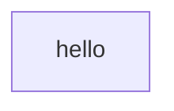

というNodeが1つ存在しています。

---

# 15. Edgeを追加する

次にEdgeを追加します。

```python
builder.add_edge(
    START,
    "hello"
)
```

さらに、

```python
builder.add_edge(
    "hello",
    END
)
```

を追加します。

これで、


というGraphになります。

---

# 16. Graphを完成させる

最後にGraphを`compile()`します。

```python
graph = builder.compile()
```

全体コードは次のようになります。

```python
from langgraph.graph import StateGraph, START, END

from state import AgentState


def hello_node(state):
    name = state["message"]

    return {
        "message": f"Hello {name}"
    }


builder = StateGraph(AgentState)


builder.add_node(
    "hello",
    hello_node
)


builder.add_edge(
    START,
    "hello"
)


builder.add_edge(
    "hello",
    END
)


graph = builder.compile()
```

これでGraphが完成しました。

---

# 17. Graphを実行する

`main.py`からGraphを実行します。

```python
from graph import graph


result = graph.invoke(
    {
        "message": "LangGraph"
    }
)


print(result["message"])
```

実行します。

```bash
python chapters/chapter07_langgraph/main.py
```

実行結果：

```text
Hello LangGraph
```

処理の流れは次の通りです。

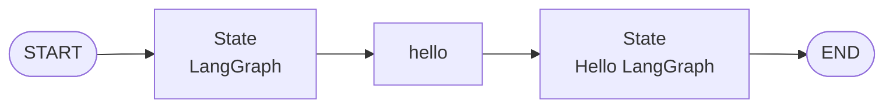

これが最初のLangGraphです。

---

# 18. Nodeを2つに増やす

次に、Nodeを増やしてみましょう。

```text
START
  ↓
hello
  ↓
upper
  ↓
END
```

というGraphを作ります。

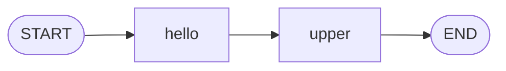

`upper_node`を追加します。

```python
def upper_node(state):
    message = state["message"]

    return {
        "message": message.upper()
    }
```

Graphへ登録します。

```python
builder.add_node(
    "upper",
    upper_node
)
```

Edgeを変更します。

```python
builder.add_edge(
    START,
    "hello"
)

builder.add_edge(
    "hello",
    "upper"
)

builder.add_edge(
    "upper",
    END
)
```

実行すると、

```text
LangGraph
    ↓
hello
    ↓
Hello LangGraph
    ↓
upper
    ↓
HELLO LANGGRAPH
```

となります。

ここで、

> **StateをNodeからNodeへ渡しながら処理している**

ことを確認してください。

---

# 19. Edgeには条件分岐もある

ここまでは、

```text
A
↓
B
↓
C
```

という一本道でした。

しかし、Agentでは条件によって処理を変える必要があります。

例えば、

```text
Toolが必要？
```

という判断です。


このように、

> **条件によって次に進むNodeを変更する**

ために利用するのが **Conditional Edge** です。

日本語にすると、

```text
条件付きのEdge
```

です。

---

# 20. 通常のEdgeとConditional Edge

違いを整理しましょう。

## 通常のEdge

必ず同じNodeへ進みます。


```text
Aの次は必ずB
```

---

## Conditional Edge

条件によって進むNodeが変わります。

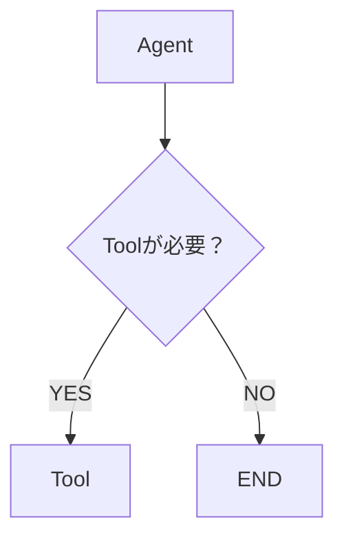

```text
Toolが必要
    ↓
Tool Node


Toolが不要
    ↓
END
```

Agentでは、このConditional Edgeが重要になります。

---

# 21. Chapter 6のAgentをGraphとして考える

ここでChapter 6へ戻ってみましょう。

Chapter 6のAgentは、

```text
考える
 ↓
Toolを使う
 ↓
結果を見る
 ↓
もう一度考える
```

という処理でした。

これをGraphとして表現すると、

```mermaid
flowchart TD
    START(["START"])

    AGENT["Agent"]

    CHECK{"Toolが必要？"}

    TOOL["Tool"]

    END(["END"])

    START --> AGENT

    AGENT --> CHECK

    CHECK -->|"YES"| TOOL

    TOOL --> AGENT

    CHECK -->|"NO"| END
```

となります。

このGraphには、

### State

```text
messages
```

### Node

```text
Agent
Tool
```

### Edge

```text
START → Agent

Tool → Agent
```

### Conditional Edge

```text
Agent → Tool

または

Agent → END
```

があります。

Chapter 6でAgentが内部的に行っていた処理を、Graphとして考えられるようになってきました。

---

# 22. Agent用のState

実際のAgentでは、Stateとして会話メッセージを保持することがよくあります。

例えば、

```text
State

messages
├── User Message
├── AI Message
├── Tool Message
├── AI Message
└── ...
```

です。

Chapter 5で利用した、

```python
messages
```

を覚えているでしょうか。

```text
User Message
     ↓
AI Message
     ↓
Tool Message
     ↓
AI Message
```

という会話履歴を管理していました。

LangGraphでは、このようなデータをStateとして管理します。

```mermaid
flowchart LR
    STATE["State<br>messages"]

    AGENT["Agent Node"]

    TOOL["Tool Node"]

    STATE --> AGENT
    AGENT --> STATE

    STATE --> TOOL
    TOOL --> STATE
```

NodeがStateを読み、

```text
処理
```

を行い、

```text
Stateを更新
```

します。

---

# 23. LangGraphでAgentを考える

最終的な構成を整理します。

```mermaid
flowchart TD
    START(["START"])

    AGENT["Agent Node<br>LLMで判断"]

    TOOL["Tool Node<br>Toolを実行"]

    END(["END"])

    START --> AGENT

    AGENT -->|"Tool Callあり"| TOOL

    TOOL -->|"Tool Result"| AGENT

    AGENT -->|"Tool Callなし"| END
```

処理の流れは、

```text
START
  ↓
Agent Node
  ↓
Toolが必要？
  │
  ├── YES
  │     ↓
  │   Tool Node
  │     ↓
  │   Agent Nodeへ戻る
  │
  └── NO
        ↓
       END
```

です。

Chapter 6で学んだAgentのループが、そのままGraphになっています。

---

# 24. LangGraphを使う理由

ここで、

> AgentはChapter 6ですでに作れたのに、なぜLangGraphを学ぶのか？

という疑問が出てくるかもしれません。

シンプルなAgentなら、Chapter 6の方法でも十分です。

しかし、処理が複雑になると、

```text
入力
 ↓
分類
 ↓
Agent A
 ↓
条件分岐
 ├── Tool A
 ├── Tool B
 └── Agent B
 ↓
レビュー
 ↓
回答
```

のような処理が必要になる場合があります。

このような処理では、

```text
どんなデータを持っている？

今どの処理？

次はどこへ進む？

どの条件で分岐する？
```

を明確にすることが重要です。

LangGraphでは、

```text
State
Node
Edge
Graph
```

として、それらを整理できます。

---

# 25. コードを書く前にGraphを描く

LangGraphを使うときは、いきなりコードを書くのではなく、最初にGraphを描くと理解しやすくなります。

例えばAgentを作りたいなら、

```mermaid
flowchart TD
    START(["START"])
    AGENT["Agent"]
    TOOL["Tool"]
    END(["END"])

    START --> AGENT
    AGENT -->|"Toolが必要"| TOOL
    TOOL --> AGENT
    AGENT -->|"回答できる"| END
```

と描きます。

次に、

```text
Stateは何？

Nodeは何？

Edgeは何？
```

を考えます。

今回なら、

| 項目 | 内容 |
| --- | --- |
| State | `messages` |
| Node | `agent`, `tool` |
| Edge | `START → agent`, `tool → agent` |
| Conditional Edge | `agent → tool / END` |

となります。

そして最後にコードへ落とします。

```text
① Graphを描く
      ↓
② Stateを決める
      ↓
③ Nodeを決める
      ↓
④ Edgeを決める
      ↓
⑤ コードを書く
```

この順番で考えると、複雑なAgentでも整理しやすくなります。

---

# 26. 演習

## 演習1：Nodeを追加する

現在のGraph、

```text
START
  ↓
hello
  ↓
upper
  ↓
END
```

に、新しいNodeを追加してください。

例えば、

```text
START
  ↓
hello
  ↓
upper
  ↓
add_exclamation
  ↓
END
```

とします。

`add_exclamation`では、

```text
HELLO LANGGRAPH
```

を、

```text
HELLO LANGGRAPH!
```

へ変更してください。

---

## 演習2：Graphを図にする

次の処理をMermaidでGraphとして表現してください。

```text
START
 ↓
Input
 ↓
LLM
 ↓
Answer
 ↓
END
```

ヒント：

```mermaid
flowchart LR
    START(["START"])
    INPUT["Input"]
    LLM["LLM"]
    ANSWER["Answer"]
    END(["END"])
```

Edgeを追加して完成させてください。

---

## 演習3：AgentのGraphを説明する

次のGraphを見て、それぞれの役割を説明してください。

```mermaid
flowchart TD
    START(["START"])

    AGENT["Agent"]

    TOOL["Tool"]

    END(["END"])

    START --> AGENT

    AGENT -->|"Toolが必要"| TOOL

    TOOL --> AGENT

    AGENT -->|"回答できる"| END
```

次の4つを考えてみましょう。

```text
Stateは何？

Nodeは何？

Edgeは何？

Conditional Edgeはどこ？
```

---

# 27. このChapterで覚えること

LangGraphには多くの機能があります。

しかし、このChapterですべて覚える必要はありません。

まずは4つです。

| 用語 | 一言でいうと |
| --- | --- |
| State | データ |
| Node | 処理 |
| Edge | 道 |
| Graph | 全体 |

そしてAgentでは、

```text
State
  ↓
Node
  ↓
State更新
  ↓
次のNode
```

という処理を繰り返します。

---

# 28. ここまでの学習を整理する

Chapter 3からの流れを整理します。

```mermaid
flowchart LR
    C3["Chapter 3<br>LLM"]

    C4["Chapter 4<br>Tool"]

    C5["Chapter 5<br>Tool Calling"]

    C6["Chapter 6<br>Agent"]

    C7["Chapter 7<br>LangGraph"]

    C3 --> C4
    C4 --> C5
    C5 --> C6
    C6 --> C7
```

それぞれ一言で表すと、

| Chapter | 学んだこと |
| --- | --- |
| Chapter 3 | LLMを呼ぶ |
| Chapter 4 | Toolを作る |
| Chapter 5 | LLMにToolを選ばせる |
| Chapter 6 | 判断と実行を繰り返す |
| Chapter 7 | 処理の流れをGraphとして表現する |

---

# 29. まとめ

このChapterでは、LangGraphの基本概念を学びました。

LangGraphを理解するために、まず覚えるのは次の4つです。

```text
State = データ

Node  = 処理

Edge  = 道

Graph = 全体
```

例えばAgentなら、

```mermaid
flowchart TD
    START(["START"])

    AGENT["Agent Node"]

    TOOL["Tool Node"]

    END(["END"])

    START --> AGENT

    AGENT -->|"Toolが必要"| TOOL

    TOOL --> AGENT

    AGENT -->|"回答できる"| END
```

というGraphとして考えることができます。

Agentの内部で行われていた、

```text
判断
 ↓
Tool実行
 ↓
結果確認
 ↓
再判断
```

という処理が、

```text
Node
+
Edge
+
State
```

によって明示的に表現できるようになりました。

> **LangGraphとは、Agentの処理をState・Node・Edgeを使ってGraphとして組み立てるための仕組み**

まずはこの理解ができていれば十分です。

---

## 次のChapter

**Chapter 8：Multi Agentを作る**

ここまでは、1つのAgentが複数のToolを利用していました。

```text
User
 │
 ▼
Agent
 │
 ├── Tool A
 ├── Tool B
 └── Tool C
 │
 ▼
Answer
```

しかし、システムが大きくなると、

```text
調査するAgent

計算するAgent

回答を作るAgent
```

のように、役割ごとにAgentを分けた方が管理しやすくなる場合があります。

次のChapterでは、

```mermaid
flowchart TD
    USER["User"]

    RESEARCH["Research Agent"]

    CALC["Calculation Agent"]

    ANSWER["Answer Agent"]

    USER --> RESEARCH
    RESEARCH --> CALC
    CALC --> ANSWER
```

のように、複数のAgentを組み合わせる **Multi Agent** の考え方を学びます。

Chapter 7で学んだ、

```text
State
Node
Edge
Graph
```

が、複数Agentを組み合わせるための土台になります。