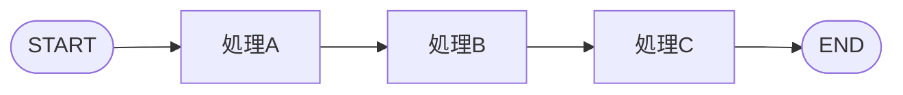
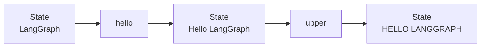
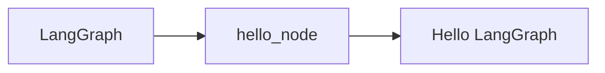
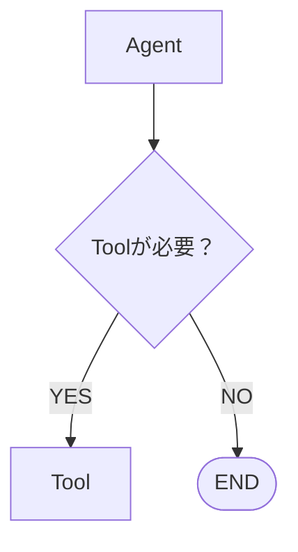
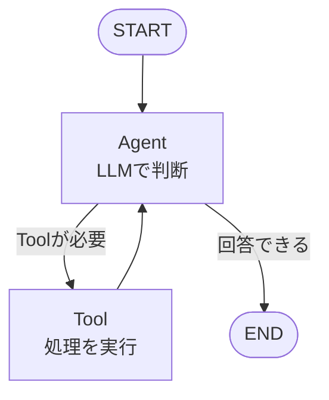
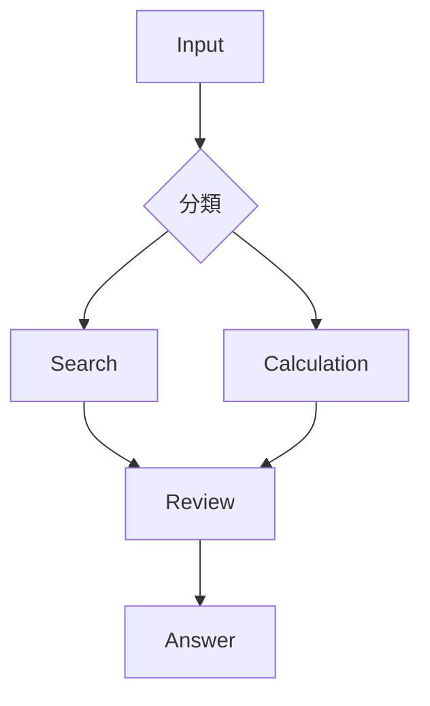
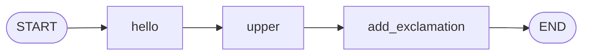
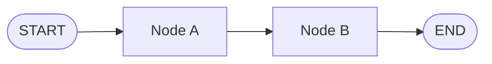
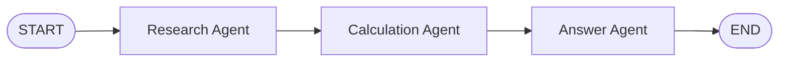

# Chapter 7: LangGraphを使う

## 前のChapterの限界と今回の解決

Chapter 6ではAgentが判断とTool実行の繰り返しを管理してくれるようになりました。一方、処理が複雑になると「どの処理があり、どの順番・条件で進むのか」をコードだけから把握しにくくなります。

```text
Chapter 6
Agentが実行ループを管理
        ↓
処理フロー全体を明示的に設計したい
        ↓
Chapter 7
State・Node・EdgeでGraphとして表現
```

このChapterではLangGraphを使い、データと処理フローを明示的に組み立てます。

---

## この章で学ぶこと

この章では、Agentの処理フローをGraphとして表現する **LangGraph** の基本を学びます。

この章を読み終えると、以下のことができるようになります。

- State、Node、Edge、Graphの基本概念を説明できる
- 処理の流れをGraphとして考えられる
- LangGraphで簡単なGraphを作成できる
- Stateを使ってNode間でデータを受け渡せる
- Chapter 6で作ったAgentをGraphとして考えられる

Chapter 6では、

```text
Agent
 │
 ├── LLMで判断
 ├── Toolを選択
 ├── Toolを実行
 └── 結果を見て再び判断
```

というAgentを作りました。

Chapter 7では、この**処理の流れそのもの**に注目します。

---

## 1. LangGraphとは

Chapter 6では、Agentが、

```text
考える
   ↓
Toolを使う
   ↓
結果を見る
   ↓
もう一度考える
```

という処理を繰り返しました。

処理が単純なうちは問題ありません。

しかし、処理が増えて、

```text
入力を確認する
      ↓
LLMで判断する
      ↓
Toolを使う
      ↓
結果を確認する
      ↓
別の処理へ進む
```

となると、

> **処理全体がどう流れているのか**

を管理する必要があります。

そこで利用できるのが **LangGraph** です。

LangGraphでは、処理をGraphとして表現します。



つまり、

> **LangGraph = AgentやLLMの処理フローをGraphとして組み立てる仕組み**

と考えてください。

---

## 2. State・Node・Edge・Graph

LangGraphを理解するために、最初に4つの言葉を覚えます。

| 用語 | 意味 |
| --- | --- |
| State | 処理中のデータ |
| Node | 処理 |
| Edge | Node同士のつながり |
| Graph | 処理全体の流れ |

まずは、

```text
State = データ

Node = 処理

Edge = 道

Graph = 全体
```

と覚えれば十分です。

例えば、


というGraphなら、

```text
hello
upper
```

が **Node**、

```text
hello → upper
```

という接続が **Edge**、

全体が **Graph** です。

そして、Node間で処理するデータが **State** です。

---

## 3. Stateは「処理中の共有データ」

Stateは、

> **Graphの処理中に保持するデータ**

です。

例えば、

```text
message = "LangGraph"
```

というStateがあるとします。

最初のNodeで、

```text
LangGraph

↓

Hello LangGraph
```

へ変更します。

次のNodeで、

```text
Hello LangGraph

↓

HELLO LANGGRAPH
```

へ変更します。



Stateを、

> **処理の途中でNode同士が共有するデータ**

と考えると分かりやすくなります。

---

### Stateには必要な共有データだけを持たせる

Stateは便利ですが、何でも保存する場所ではありません。基本原則は、**後続のNodeが必要とする共有データだけを持たせる**ことです。

```text
後続Nodeが必要
      ↓
Stateに持たせる

そのNodeの中だけで使う一時データ
      ↓
Stateに持たせない
```

Stateが大きくなりすぎると、どのNodeがどの値を読み書きするのか分かりにくくなり、変更時の影響範囲も広がります。

例えば、後続Nodeが必要とするのが `message` だけなら、まずは次のような小さいStateで十分です。

```python
class GraphState(TypedDict):
    message: str
```

**「この値は次のNodeへ渡す必要があるか？」**を基準にStateへ追加するか判断します。

---

### Chapter 6から何が増えるのか

Chapter 6ではAgent内部の実行制御に任せていた処理フローを、このChapterではGraphとして明示します。新しく意識する中心要素は次の4つです。

```text
State = データ
Node  = 処理
Edge  = 道
Graph = 全体
```

つまり新しい点は「LLMやToolを増やすこと」ではなく、**処理の流れを構造として定義すること**です。

---

## 4. 最初のGraphを作る

まずは、できるだけ小さなGraphを作ります。


ディレクトリは次のようにします。

```text
examples/
└── chapter07_langgraph/
    ├── README.md
    ├── main.py
    ├── graph.py
    └── state.py
```

このGraphでは、

```text
START
  ↓
hello
  ↓
END
```

という処理だけを実行します。

---

## 5. Stateを定義する

まず、`state.py`を作ります。

```python
from typing import TypedDict


class GraphState(TypedDict):
    message: str
```

今回のStateは、

```text
message
```

だけを持ちます。

```text
GraphState
│
└── message
```

例えば、

```python
{
    "message": "LangGraph"
}
```

というデータをGraphへ渡します。

このデータが、Nodeを通りながら更新されていきます。

---

## 6. Nodeを作る

次にNodeを作ります。

Nodeは、

> **Stateを受け取り、処理を行う関数**

と考えることができます。

今回は、

```python
def hello_node(state):
    name = state["message"]

    return {
        "message": f"Hello {name}"
    }
```

というNodeを作ります。

このNodeは、

```text
入力

message = "LangGraph"
```

を受け取り、

```text
出力

message = "Hello LangGraph"
```

を返します。



つまりNodeでは、

```text
Stateを読む
    ↓
処理する
    ↓
Stateを更新する
```

という処理を行います。

---

## 7. Graphを作る

`graph.py`を作ります。

まず必要なものをimportします。

```python
from langgraph.graph import StateGraph, START, END

from state import GraphState
```

Nodeを定義します。

```python
def hello_node(state):
    name = state["message"]

    return {
        "message": f"Hello {name}"
    }
```

次にGraphを作ります。

```python
builder = StateGraph(GraphState)
```

Nodeを登録します。

```python
builder.add_node(
    "hello",
    hello_node
)
```

Edgeを追加します。

```python
builder.add_edge(
    START,
    "hello"
)

builder.add_edge(
    "hello",
    END
)
```

最後にGraphを完成させます。

```python
graph = builder.compile()
```

`graph.py`全体は次のようになります。

```python
from langgraph.graph import StateGraph, START, END

from state import GraphState


def hello_node(state):
    name = state["message"]

    return {
        "message": f"Hello {name}"
    }


builder = StateGraph(GraphState)


builder.add_node(
    "hello",
    hello_node
)


builder.add_edge(
    START,
    "hello"
)

builder.add_edge(
    "hello",
    END
)


graph = builder.compile()
```

コードとGraphを対応させると、


となります。

---

## 8. Graphを実行する

`main.py`からGraphを実行します。

```python
from graph import graph


result = graph.invoke(
    {
        "message": "LangGraph"
    }
)


print(result["message"])
```

実行します。

```bash
python examples/chapter07_langgraph/main.py
```

結果は、

```text
Hello LangGraph
```

となります。

内部では、

```text
① Stateを作る

message = "LangGraph"

        ↓

② START

        ↓

③ hello Node

        ↓

④ Stateを更新

message = "Hello LangGraph"

        ↓

⑤ END
```

という処理が行われています。

---

## 9. Nodeを追加する

Graphの特徴は、処理をNodeとして追加していけることです。

次に、

```text
文字を大文字にする
```

Nodeを追加します。

```python
def upper_node(state):
    message = state["message"]

    return {
        "message": message.upper()
    }
```

Graphへ登録します。

```python
builder.add_node(
    "upper",
    upper_node
)
```

Edgeも変更します。

```python
builder.add_edge(
    START,
    "hello"
)

builder.add_edge(
    "hello",
    "upper"
)

builder.add_edge(
    "upper",
    END
)
```

Graphは、


となります。

Stateは、

```text
LangGraph

↓

Hello LangGraph

↓

HELLO LANGGRAPH
```

と変化します。

ここまで理解できれば、

```text
State
Node
Edge
Graph
```

の基本は理解できています。

---

## 10. 処理を分岐する

ここまでは、

```text
A
↓
B
↓
C
```

という固定された処理でした。

しかし実際のAgentでは、

```text
Toolが必要ならToolへ

Toolが不要なら終了
```

のような分岐が必要になります。



LangGraphでは、このような分岐を **Conditional Edge** で表現できます。

通常のEdgeは、

```text
A
↓
B
```

と次のNodeが決まっています。

Conditional Edgeでは、

```text
       ┌→ B
A ─────┤
       └→ C
```

のように、条件によって次のNodeを変更できます。

| Edge | 動き |
| --- | --- |
| Edge | 次のNodeが固定 |
| Conditional Edge | 条件によって次のNodeを変更 |

このChapterでは、

> **LangGraphでは処理を分岐できる**

ということだけ覚えておけば十分です。

Conditional Edgeは、Chapter 9のOrchestratorで実際に使用します。

---

## 11. Chapter 6のAgentをGraphとして考える

Chapter 6では、Agentが、

```text
考える
   ↓
Toolを使う
   ↓
結果を見る
   ↓
もう一度考える
```

という処理をしていました。

これをGraphとして表すと、



となります。

LangGraphの言葉に置き換えると、

| 要素 | 内容 |
| --- | --- |
| State | 会話や処理中のデータ |
| Agent Node | LLMで次の処理を判断 |
| Tool Node | Toolを実行 |
| Edge | Node間を移動 |
| Conditional Edge | Toolを使うか終了するか判断 |

つまりChapter 6で作ったAgentも、

> **Stateを持ちながらNode間を移動するGraph**

として考えることができます。

---

## 12. LangGraphを使う理由

簡単な処理なら、必ずしもLangGraphは必要ありません。

例えば、

```text
User
 ↓
LLM
 ↓
Answer
```

だけなら、通常のPythonコードでも十分です。

LangGraphが役立つのは、処理が複雑になった場合です。

例えば、



このように、

```text
処理が複数ある

分岐がある

ループがある

複数Agentがいる
```

場合、Graphとして表現すると処理全体を理解しやすくなります。

そのため、LangGraphを使うときは、いきなりコードを書くのではなく、

```text
① Graphを描く

      ↓

② Stateを決める

      ↓

③ Nodeを決める

      ↓

④ Edgeを決める

      ↓

⑤ コードを書く
```

という順番で考えると整理しやすくなります。

---

## 13. 演習

### 演習1：Nodeを追加する

次のGraphを作ってください。



`add_exclamation`では、

```text
HELLO LANGGRAPH

↓

HELLO LANGGRAPH!
```

となるようにしてください。

例えば、

```python
def add_exclamation_node(state):
    return {
        "message": state["message"] + "!"
    }
```

と実装できます。

---

### 演習2：Graphを先に描く

次の処理をMermaidで表現してください。

```text
START
 ↓
Input
 ↓
LLM
 ↓
Answer
 ↓
END
```

コードを書く前に、

```text
Stateは何か？

Nodeは何か？

Edgeはどこか？
```

を考えてみましょう。

---

### 演習3：Agent Graphを説明する

次のGraphについて、


以下を説明してみてください。

```text
Stateとは何か？

Nodeはどれか？

Edgeはどれか？

Conditional Edgeはどこか？
```

説明できれば、LangGraphの基本概念を理解できています。

---

### 演習の確認ポイント

次を確認できれば、このChapterの演習は完了です。

- `add_exclamation` Nodeを追加し、期待した順序でStateを更新できる
- コードを書く前に処理をGraphとして描ける
- Graphを見てState・Node・Edge・Conditional Edgeを区別できる
- 「State = データ、Node = 処理、Edge = 道、Graph = 全体」を自分の言葉で説明できる


## 14. まとめ

このChapterでは、**LangGraph** の基本を学びました。

LangGraphでは、処理をGraphとして考えます。



最も重要なのは、次の4つです。

| 用語 | 覚え方 |
| --- | --- |
| State | データ |
| Node | 処理 |
| Edge | 道 |
| Graph | 全体 |

NodeはStateを使って処理します。

```text
Stateを読む
    ↓
Nodeで処理
    ↓
Stateを更新
```

Edgeによって次のNodeへ進みます。

```text
Node A
  ↓
Node B
  ↓
Node C
```

さらにConditional Edgeを使えば、

```text
       ┌→ Node B
Node A ┤
       └→ Node C
```

のような分岐も作れます。

LangGraphを使うときは、

```text
Graph
 ↓
State
 ↓
Node
 ↓
Edge
 ↓
Code
```

の順番で設計すると整理しやすくなります。

---

# 次のChapter

**Chapter 8: Multi Agent構成を作る**

Chapter 7では、

```text
1つのGraphの中に
複数のNodeを配置する
```

ことを学びました。

次のChapterでは、Nodeとして扱う処理をさらに役割ごとのAgentへ分けます。



つまり、

```text
Single Agent

      ↓

LangGraph

      ↓

Multi Agent
```

へ発展させていきます。

---

## Chapterナビゲーション

← [Chapter 6：単一Agent](06_agent.md) ｜ [Chapter 8：Multi Agent](08_multi_agent.md) →
