# Chapter 8: Multi Agent構成を作る

## この章で学ぶこと

この章では、複数のAgentに役割を分ける **Multi Agent** の基本を学びます。

この章を読み終えると、以下のことができるようになります。

- 複数Agentに役割を分ける理由を説明できる
- 単一AgentとMulti Agentの違いを理解する
- Agentごとに役割を定義する考え方を理解する
- Stateを使ってAgent間で情報を受け渡す方法を理解する
- LangGraphを使って複数Agentを接続できる
- Multi Agentの基本的な処理フローを設計できる

---

# 1. Chapter 7のおさらい

Chapter 7では、LangGraphの基本を学びました。

重要だったのは次の4つです。

| 用語 | 意味 |
| --- | --- |
| State | データ |
| Node | 処理 |
| Edge | 道 |
| Graph | 全体 |

例えば、単一Agentの処理を次のようなGraphとして考えました。

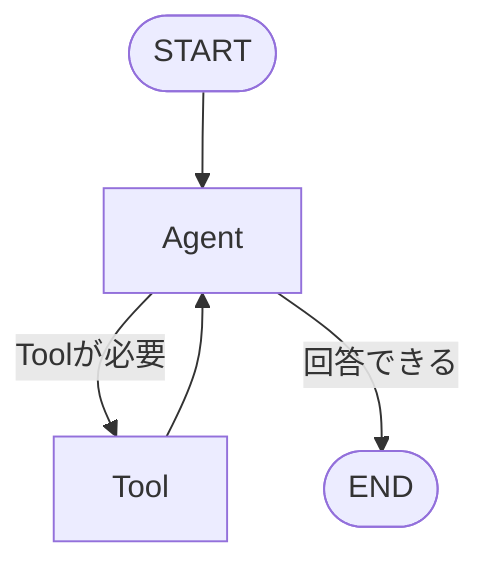

Chapter 8では、このGraphをさらに発展させます。

これまでは、

```text
1つのAgent
```

が処理を担当していました。

今回から、

```text
複数のAgent
```

に役割を分けます。

---

# 2. なぜAgentを複数に分けるのか

例えば、旅行プランを作るAgentを考えてみましょう。

ユーザーから、

```text
東京から大阪へ2泊3日で旅行したいです。
予算は5万円です。
```

と依頼されたとします。

1つのAgentですべて処理するなら、

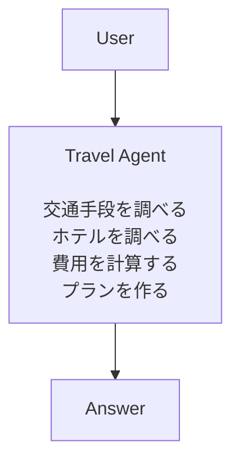

となります。

このAgentには、

```text
調査
計算
判断
回答作成
```

など、多くの役割があります。

システムが小さいうちは問題ありません。

しかし、処理が増えると、

```text
Agentの役割が多すぎる
```

状態になります。

---

# 3. 役割ごとにAgentを分ける

そこで、役割ごとにAgentを分けます。

例えば、

```text
調査
  ↓
Research Agent

計算
  ↓
Calculation Agent

回答作成
  ↓
Answer Agent
```

とします。

Graphで表すと、

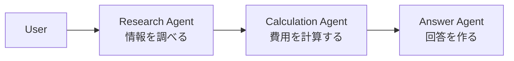

それぞれのAgentが、自分の担当に集中します。

| Agent | 役割 |
| --- | --- |
| Research Agent | 情報を調査する |
| Calculation Agent | 数値を計算する |
| Answer Agent | 最終回答を作る |

このように、

> **複数のAgentに役割を分担させる構成**

を **Multi Agent** と呼びます。

---

# 4. 単一AgentとMulti Agent

違いを整理しましょう。

## 単一Agent

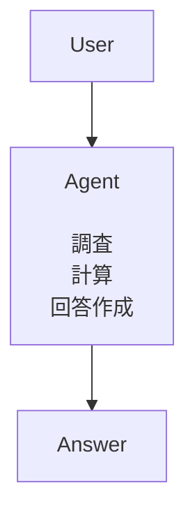

1つのAgentが複数の役割を担当します。

---

## Multi Agent

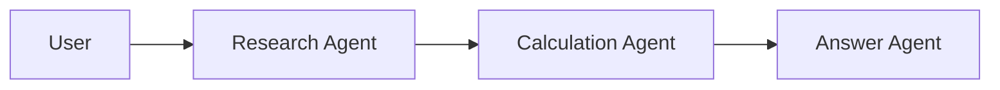

役割ごとにAgentを分けます。

---

## 比較

| | 単一Agent | Multi Agent |
| --- | --- | --- |
| Agent数 | 1 | 複数 |
| 役割 | 1つのAgentに集約 | Agentごとに分担 |
| 構成 | シンプル | やや複雑 |
| 責務 | 広くなりやすい | 明確にしやすい |
| 向いている処理 | 小規模 | 複数の専門処理 |

重要なのは、

> **Multi Agentの方が必ず優れているわけではない**

ということです。

1つのAgentで十分なら、単一Agentの方がシンプルです。

役割を分ける意味がある場合にMulti Agentを使います。

---

# 5. Multi Agentは「チーム」と考える

Multi Agentが分かりにくい場合は、会社のチームに置き換えて考えてみましょう。

例えば旅行プランを作るチームなら、

```text
調査担当
  ↓
交通・ホテルを調べる


計算担当
  ↓
予算を計算する


回答担当
  ↓
情報をまとめて提案する
```

という役割分担ができます。

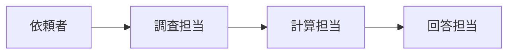

AI Agentでも同じです。

```text
調査担当
      ↓
Research Agent


計算担当
      ↓
Calculation Agent


回答担当
      ↓
Answer Agent
```

> **Multi Agent = AI Agentによるチーム**

と考えるとイメージしやすくなります。

---

# 6. 今回作るMulti Agent

このChapterでは、次の構成を作ります。


役割は次の通りです。

| Agent | 役割 |
| --- | --- |
| Research Agent | 必要な情報を整理する |
| Calculation Agent | 数値を計算する |
| Answer Agent | 最終回答を作る |

このChapterでは理解を優先するため、

```text
Research
   ↓
Calculation
   ↓
Answer
```

という**固定された順番**で処理します。

> **Note**
>
> 「次にどのAgentへ仕事を任せるのか」を動的に判断する仕組みは、Chapter 9のOrchestratorで学びます。

---

# 7. Agent間でどうやって情報を渡すのか

Multi Agentでは重要な問題があります。

例えば、Research Agentが、

```text
交通費: 20,000円
ホテル代: 18,000円
```

という情報を取得したとします。

Calculation Agentは、この情報を受け取らなければ計算できません。

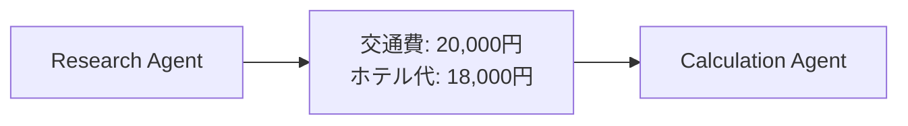

では、どうやって情報を渡すのでしょうか。

ここでChapter 7で学んだ **State** を使います。

---

# 8. StateをAgent間の共有データとして使う

Chapter 7では、

> **State = 処理中のデータ**

と学びました。

Multi Agentでも同じです。

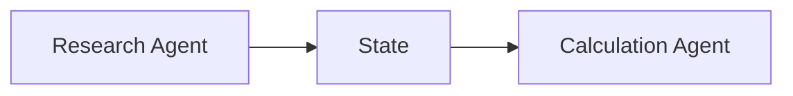

Research AgentがStateへ結果を書き込みます。

```text
State

research_result:
  交通費: 20,000円
  ホテル代: 18,000円
```

Calculation Agentは、このStateを読みます。

```text
State
  ↓
Calculation Agent
  ↓
20,000 + 18,000
  ↓
38,000円
```

そして計算結果をStateへ追加します。

```text
State

research_result:
  交通費: 20,000円
  ホテル代: 18,000円

calculation_result:
  合計: 38,000円
```

次のAnswer Agentは、このStateを利用して回答を作ります。

---

# 9. Stateを「共有ホワイトボード」と考える

Multi Agentでは、Stateを**チーム全員が見る共有ホワイトボード**と考えると分かりやすくなります。

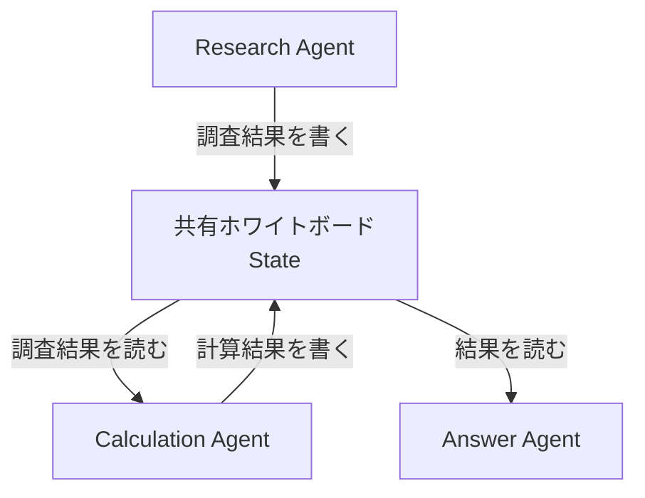

それぞれのAgentが、

```text
Stateを読む
   ↓
自分の仕事をする
   ↓
Stateを更新する
```

という流れで処理します。

---

# 10. Multi Agentの処理フロー

今回の処理を整理します。

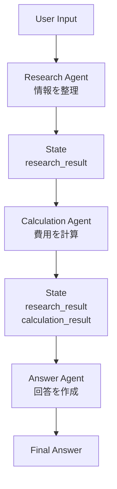

ポイントは、

> **AgentからAgentへ直接データを渡すというより、Stateを更新しながら処理を進める**

という考え方です。

---

# 11. Stateを定義する

Chapter 8では、次のディレクトリ構成を使います。

```text
chapters/
└── chapter08_multi_agent/
    ├── README.md
    ├── main.py
    ├── graph.py
    ├── state.py
    └── agents/
        ├── __init__.py
        ├── research.py
        ├── calculation.py
        └── answer.py
```

まず`state.py`を作ります。

```python
from typing import TypedDict


class AgentState(TypedDict):
    user_request: str
    research_result: str
    calculation_result: str
    final_answer: str
```

Stateには、次の情報を保持します。

| 項目 | 内容 |
| --- | --- |
| `user_request` | ユーザーの依頼 |
| `research_result` | Research Agentの結果 |
| `calculation_result` | Calculation Agentの結果 |
| `final_answer` | Answer Agentが作った回答 |

図にすると、

```text
AgentState
│
├── user_request
├── research_result
├── calculation_result
└── final_answer
```

となります。

---

# 12. Research Agentを作る

最初にResearch Agentを作ります。

`agents/research.py`

```python
def research_agent(state):
    user_request = state["user_request"]

    print(f"Research Agent: {user_request}")

    return {
        "research_result": (
            "交通費は20,000円、"
            "ホテル代は18,000円です。"
        )
    }
```

このChapterではMulti Agentの構造を理解することが目的なので、調査結果は固定値にしています。

実際のシステムでは、

```text
Research Agent
      │
      ├── Web Search Tool
      ├── Database Tool
      └── API Tool
```

のようにToolを利用できます。

処理は、

```text
State
 │
 │ user_request
 ▼
Research Agent
 │
 │ 調査
 ▼
State
 │
 └── research_result
```

となります。

---

# 13. Calculation Agentを作る

次にCalculation Agentを作ります。

`agents/calculation.py`

```python
def calculation_agent(state):
    research_result = state["research_result"]

    print(f"Calculation Agent: {research_result}")

    return {
        "calculation_result": "合計費用は38,000円です。"
    }
```

Calculation Agentは、Research Agentが作った、

```text
research_result
```

をStateから取得します。

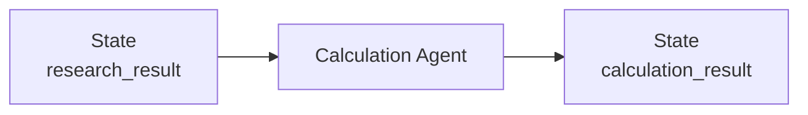

実際のシステムでは、Calculation Agentに計算Toolを持たせることもできます。

```text
Calculation Agent
       │
       ▼
Calculator Tool
```

---

# 14. Answer Agentを作る

最後にAnswer Agentを作ります。

`agents/answer.py`

```python
def answer_agent(state):
    research_result = state["research_result"]
    calculation_result = state["calculation_result"]

    final_answer = (
        f"{research_result}\n"
        f"{calculation_result}"
    )

    return {
        "final_answer": final_answer
    }
```

Answer Agentは、

```text
research_result

+

calculation_result
```

を使って最終回答を作ります。

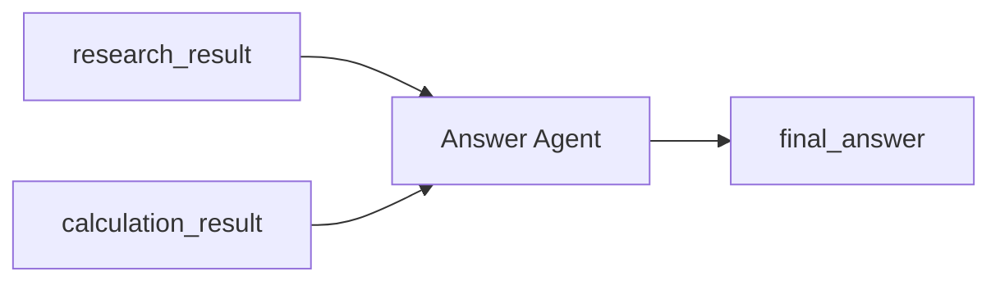

---

# 15. 3つのAgentを整理する

ここまでで、3つのAgentができました。

```text
Research Agent
      │
      └── research_result


Calculation Agent
      │
      └── calculation_result


Answer Agent
      │
      └── final_answer
```

役割を表にすると、

| Agent | 読み取るState | 更新するState |
| --- | --- | --- |
| Research | `user_request` | `research_result` |
| Calculation | `research_result` | `calculation_result` |
| Answer | `research_result`, `calculation_result` | `final_answer` |

このように、

> **どのAgentが、何を読み、何を書くのか**

を明確にしておくことが重要です。

---

# 16. AgentをLangGraphのNodeにする

Chapter 7では、

> **Node = 処理**

と学びました。

今回作ったAgentも、それぞれNodeとしてGraphへ登録できます。

```text
Python関数
research_agent()
      ↓
Research Node


Python関数
calculation_agent()
      ↓
Calculation Node


Python関数
answer_agent()
      ↓
Answer Node
```

Graphにすると、

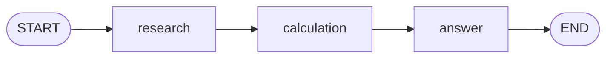

---

# 17. Multi Agent Graphを作る

`graph.py`を作ります。

```python
from langgraph.graph import StateGraph, START, END

from state import AgentState

from agents.research import research_agent
from agents.calculation import calculation_agent
from agents.answer import answer_agent


builder = StateGraph(AgentState)
```

まず、3つのAgentをNodeとして登録します。

```python
builder.add_node(
    "research",
    research_agent
)

builder.add_node(
    "calculation",
    calculation_agent
)

builder.add_node(
    "answer",
    answer_agent
)
```

---

# 18. Agent同士をEdgeで接続する

次にEdgeを追加します。

```python
builder.add_edge(
    START,
    "research"
)

builder.add_edge(
    "research",
    "calculation"
)

builder.add_edge(
    "calculation",
    "answer"
)

builder.add_edge(
    "answer",
    END
)
```

これによって、

```text
START
  ↓
research
  ↓
calculation
  ↓
answer
  ↓
END
```

という処理になります。


最後にGraphを完成させます。

```python
graph = builder.compile()
```

---

# 19. Graph全体を確認する

`graph.py`全体は次のようになります。

```python
from langgraph.graph import StateGraph, START, END

from state import AgentState

from agents.research import research_agent
from agents.calculation import calculation_agent
from agents.answer import answer_agent


builder = StateGraph(AgentState)


builder.add_node(
    "research",
    research_agent
)

builder.add_node(
    "calculation",
    calculation_agent
)

builder.add_node(
    "answer",
    answer_agent
)


builder.add_edge(
    START,
    "research"
)

builder.add_edge(
    "research",
    "calculation"
)

builder.add_edge(
    "calculation",
    "answer"
)

builder.add_edge(
    "answer",
    END
)


graph = builder.compile()
```

コードだけを見ると長く感じますが、やっていることはシンプルです。

```text
Stateを決める

↓

AgentをNodeにする

↓

Edgeで接続する

↓

Graphを完成させる
```

---

# 20. Multi Agentを実行する

`main.py`からGraphを実行します。

```python
from graph import graph


result = graph.invoke(
    {
        "user_request": (
            "東京から大阪へ2泊3日で旅行したいです。"
            "予算は5万円です。"
        ),
        "research_result": "",
        "calculation_result": "",
        "final_answer": ""
    }
)


print(result["final_answer"])
```

実行します。

```bash
python chapters/chapter08_multi_agent/main.py
```

例えば、

```text
交通費は20,000円、ホテル代は18,000円です。
合計費用は38,000円です。
```

と表示されます。

---

# 21. 内部では何が起きているのか

実行した処理をStateの変化と一緒に確認してみましょう。

## 最初のState

```text
user_request:
  東京から大阪へ2泊3日で旅行したい。
  予算は5万円。

research_result:
  ""

calculation_result:
  ""

final_answer:
  ""
```

↓

### Research Agent

```text
research_result:
  交通費は20,000円、
  ホテル代は18,000円です。
```

↓

### Calculation Agent

```text
calculation_result:
  合計費用は38,000円です。
```

↓

### Answer Agent

```text
final_answer:
  交通費は20,000円、
  ホテル代は18,000円です。
  合計費用は38,000円です。
```

つまり、

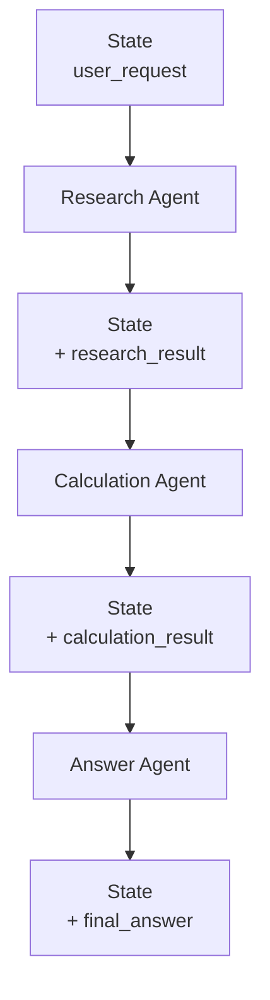

という流れになっています。

---

# 22. Agent間で直接呼び出しているわけではない

ここは重要なポイントです。

今回、

```text
Research Agent
      ↓
Calculation Agent
```

と図で表しています。

しかし、Research Agentのコードから、

```python
calculation_agent(...)
```

と直接呼び出しているわけではありません。

実際には、

```text
Research Agent
      │
      │ Stateを更新
      ▼
    State
      │
      │ Graphが次のNodeへ進む
      ▼
Calculation Agent
```

という構造です。

つまり、

```text
Agent A
   ↓
Agent B
```

ではなく、

```text
Agent A
   ↓
State
   ↓
Graph
   ↓
Agent B
```

と考えると、LangGraphの構造を理解しやすくなります。

---

# 23. AgentごとにToolを持たせることもできる

今回のコードでは、Multi Agentの構造を理解するために処理をシンプルにしています。

しかし、Chapter 6で学んだように、AgentはToolを利用できます。

例えば、

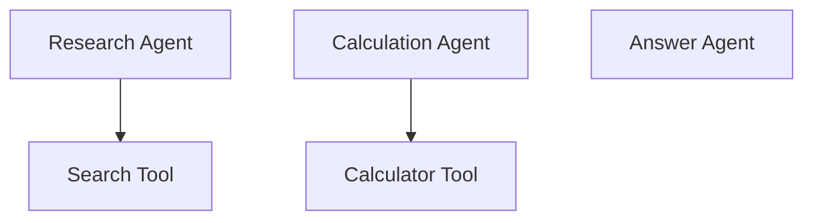

とすることもできます。

役割を整理すると、

```text
Research Agent
    │
    └── Search Tool


Calculation Agent
    │
    └── Calculator Tool


Answer Agent
    │
    └── 最終回答を作る
```

となります。

重要なのは、

> **Agentごとに必要なToolだけを持たせられる**

という点です。

---

# 24. 役割を分けるメリット

例えば、すべてのToolを1つのAgentへ渡した場合、

```text
Travel Agent
 │
 ├── Search Tool
 ├── Hotel Tool
 ├── Route Tool
 ├── Calculator Tool
 ├── Weather Tool
 └── Report Tool
```

となります。

Agentが多くの責務を持つことになります。

一方、役割を分けると、

```text
Research Agent
 │
 ├── Search Tool
 ├── Hotel Tool
 └── Route Tool


Calculation Agent
 │
 └── Calculator Tool


Answer Agent
 │
 └── Report Tool
```

のように整理できます。

それぞれのAgentが、

> **自分の仕事に必要な機能だけを持つ**

構成にできます。

---

# 25. ただし、分けすぎない

Multi Agentを学ぶと、

```text
処理ごとにAgentを作ればいいのでは？
```

と思うかもしれません。

しかし、Agentを増やすと構成も複雑になります。

例えば、

```text
Agent A
 ↓
Agent B
 ↓
Agent C
 ↓
Agent D
 ↓
Agent E
```

となると、

```text
誰が何を担当する？

どのStateを読む？

どのStateを更新する？

エラーが起きたのはどこ？

どの順番で動く？
```

を管理する必要があります。

そのため、

> **役割を分ける意味がある場合だけAgentを分ける**

ことが重要です。

```text
1つで十分
   ↓
Single Agent


明確に役割が違う
   ↓
Multi Agent
```

---

# 26. Single AgentとMulti Agentの判断

例えば、次のように考えることができます。

| 状況 | 構成 |
| --- | --- |
| Toolが2〜3個程度 | Single Agent |
| 処理が単純 | Single Agent |
| 1つの役割で説明できる | Single Agent |
| 調査・計算など役割が明確に違う | Multi Agentを検討 |
| Agentごとに異なるToolを持たせたい | Multi Agentを検討 |
| Agentごとに異なる指示を与えたい | Multi Agentを検討 |

Multi Agentは、

> **複雑だから使う**

のではなく、

> **役割を分離するメリットがあるから使う**

と考えましょう。

---

# 27. 今回のMulti Agentにはまだ問題がある

今回作ったGraphをもう一度見てみましょう。


このGraphには、1つ大きな特徴があります。

それは、

> **必ずResearch → Calculation → Answerの順番で動く**

ということです。

例えば、

```text
大阪旅行について調べてください。
```

という依頼でも、

```text
Research
 ↓
Calculation
 ↓
Answer
```

と進みます。

本当にCalculation Agentは必要でしょうか？

逆に、

```text
100と200を足してください。
```

という質問でも、

```text
Research
```

から始まってしまいます。

---

# 28. 誰かが仕事を振り分ける必要がある

理想的には、ユーザーの依頼を見て、

```text
これは調査が必要
    ↓
Research Agent


これは計算が必要
    ↓
Calculation Agent


もう回答できる
    ↓
Answer Agent
```

と判断できると便利です。

つまり、

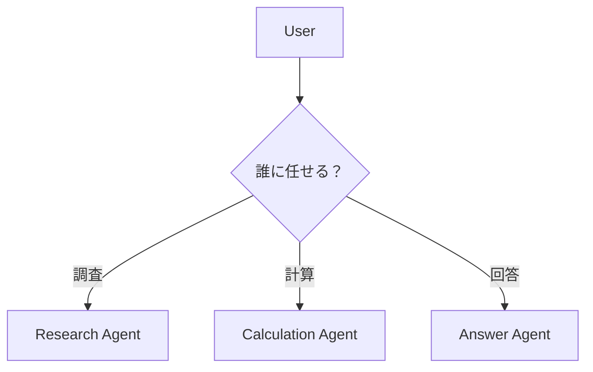

という構成です。

この、

> **誰に仕事を任せるかを判断する役割**

を担当するのが、次のChapterで学ぶ **Orchestrator** です。

---

# 29. 演習

## 演習1：Agentの役割を確認する

今回作った3つのAgentについて、

```text
何を読む？

何をする？

何を書く？
```

を整理してください。

例えば、

```text
Research Agent

読む:
user_request

処理:
情報を調査する

書く:
research_result
```

という形です。

---

## 演習2：新しいAgentを追加する

次のAgentを追加してみましょう。

```text
Review Agent
```

役割は、

```text
Answer Agentが作った回答を確認する
```

です。

Graphを、

```text
START
 ↓
Research
 ↓
Calculation
 ↓
Answer
 ↓
Review
 ↓
END
```

へ変更してください。

Mermaidで表すと、


となります。

---

## 演習3：Stateを追加する

Review Agentの結果を保存するため、

```text
review_result
```

をStateへ追加してください。

```text
AgentState
│
├── user_request
├── research_result
├── calculation_result
├── final_answer
└── review_result
```

Review Agentが、

```text
final_answerを読む

↓

レビューする

↓

review_resultを書く
```

という処理になるようにしてください。

---

# 30. このChapterで覚えること

Multi Agentについて、最初から複雑な仕組みを覚える必要はありません。

重要なのは3つです。

### 1. Agentごとに役割を分ける

```text
Research Agent
= 調査


Calculation Agent
= 計算


Answer Agent
= 回答
```

---

### 2. Stateで情報を共有する

```text
Agent
 ↓
State更新
 ↓
次のAgent
```

Agent間で必要な情報をStateへ保存します。

---

### 3. GraphでAgentを接続する

```text
Research
   ↓
Calculation
   ↓
Answer
```

どの順番でAgentを実行するのかをEdgeで定義します。

---

# 31. ここまでの学習を整理する

Chapter 3からの流れを整理します。

```mermaid
flowchart LR
    C3["Chapter 3<br>LLM"]

    C4["Chapter 4<br>Tool"]

    C5["Chapter 5<br>Tool Calling"]

    C6["Chapter 6<br>Single Agent"]

    C7["Chapter 7<br>LangGraph"]

    C8["Chapter 8<br>Multi Agent"]

    C3 --> C4
    C4 --> C5
    C5 --> C6
    C6 --> C7
    C7 --> C8
```

それぞれ一言で表すと、

| Chapter | 学んだこと |
| --- | --- |
| Chapter 3 | LLMを呼ぶ |
| Chapter 4 | Toolを作る |
| Chapter 5 | LLMにToolを選ばせる |
| Chapter 6 | Agentとして判断と実行を繰り返す |
| Chapter 7 | 処理をGraphとして表現する |
| Chapter 8 | 複数Agentに役割を分ける |

---

# 32. まとめ

このChapterでは、**Multi Agent** の基本を学びました。

Multi Agentとは、

> **複数のAgentに役割を分けて処理する構成**

です。

例えば、

```mermaid
flowchart LR
    USER["User"]

    RESEARCH["Research Agent<br>調査"]

    CALC["Calculation Agent<br>計算"]

    ANSWER["Answer Agent<br>回答"]

    USER --> RESEARCH
    RESEARCH --> CALC
    CALC --> ANSWER
```

という構成です。

Agent間の情報は、Stateを使って共有できます。

```text
Research Agent
      ↓
State
research_result
      ↓
Calculation Agent
      ↓
State
calculation_result
      ↓
Answer Agent
```

Multi Agentを理解するうえで、まず覚えてほしいのは次の3つです。

```text
役割を分ける

      +

Stateで情報を共有する

      +

GraphでAgentをつなぐ
```

ただし、

> **Agentは多ければ多いほど良いわけではありません。**

1つのAgentで十分ならSingle Agentを使い、役割を分離する意味がある場合にMulti Agentを検討します。

---

## 次のChapter

**Chapter 9：Orchestratorを作る**

Chapter 8では、

```text
Research
   ↓
Calculation
   ↓
Answer
```

という固定された順番でAgentを実行しました。

次のChapterでは、

```text
誰に仕事を任せる？
```

を判断するAgentを追加します。

```mermaid
flowchart TD
    USER["User"]

    ORCHESTRATOR["Orchestrator<br>誰に任せる？"]

    RESEARCH["Research Agent"]

    CALC["Calculation Agent"]

    ANSWER["Answer Agent"]

    USER --> ORCHESTRATOR

    ORCHESTRATOR -->|"調査が必要"| RESEARCH

    ORCHESTRATOR -->|"計算が必要"| CALC

    ORCHESTRATOR -->|"回答できる"| ANSWER

    RESEARCH --> ORCHESTRATOR

    CALC --> ORCHESTRATOR

    ANSWER --> ORCHESTRATOR
```

Orchestrator自身がすべての仕事をするわけではありません。

> **Orchestrator = 誰に仕事を任せるかを判断し、全体の処理を制御するAgent**

Chapter 9では、この構成をLangGraphで実装します。