# Chapter 8: Multi Agent構成を作る

## この章で学ぶこと

この章では、複数のAgentに役割を分ける **Multi Agent** の基本を学びます。

この章を読み終えると、以下のことができるようになります。

- 複数Agentに役割を分ける理由を説明できる
- 単一AgentとMulti Agentの違いを理解する
- Agentごとに役割を定義できる
- Stateを使ってAgent間で情報を受け渡せる
- LangGraphを使って複数Agentを接続できる

Chapter 7までは、1つのAgentを中心に処理していました。

Chapter 8では、

```text
1つのAgentが全部やる

        ↓

役割ごとにAgentを分ける
```

という考え方へ進みます。

---

## 1. なぜAgentを複数に分けるのか

例えば、旅行プランを作るAgentを考えてみましょう。

ユーザーから、

```text
東京から大阪へ2泊3日で旅行したいです。
予算は5万円です。
```

と依頼されたとします。

1つのAgentですべて処理するなら、

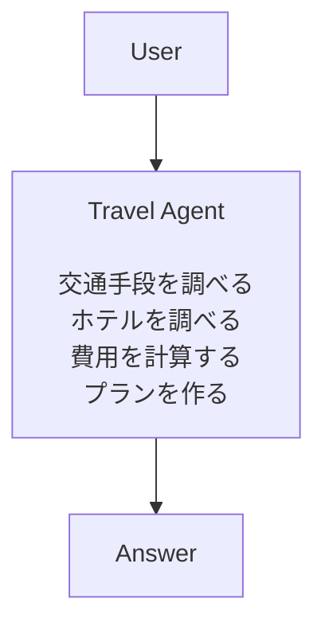

となります。

小さなシステムなら、これでも問題ありません。

しかし処理が増えると、1つのAgentが、

```text
調査
計算
判断
回答作成
```

など、多くの役割を担当することになります。

そこで、役割ごとにAgentを分けます。

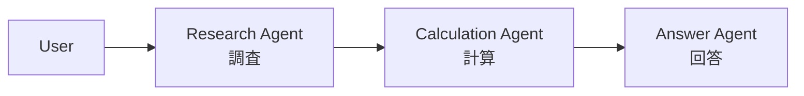

このように、

> **複数のAgentに役割を分担させる構成**

を **Multi Agent** と呼びます。

---

## 2. 単一AgentとMulti Agentの違い

### 単一Agent

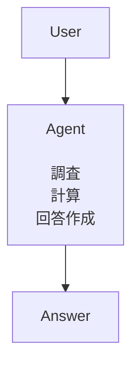

1つのAgentが複数の役割を担当します。

### Multi Agent

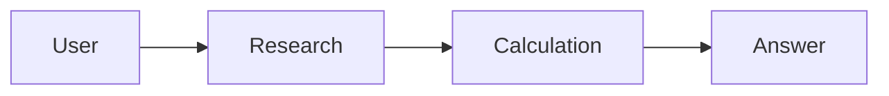

役割ごとにAgentを分けます。

違いを整理すると、

| | 単一Agent | Multi Agent |
| --- | --- | --- |
| Agent数 | 1 | 複数 |
| 役割 | 1つに集約 | Agentごとに分担 |
| 構成 | シンプル | やや複雑 |
| 責務 | 広くなりやすい | 明確にしやすい |
| 向いている処理 | 小規模 | 複数の専門処理 |

重要なのは、

> **Multi Agentの方が必ず優れているわけではない**

ということです。

1つのAgentで十分なら、単一Agentの方がシンプルです。

---

## 3. 今回作るMulti Agent

このChapterでは、3つのAgentを作ります。

| Agent | 役割 |
| --- | --- |
| Research Agent | 必要な情報を調査する |
| Calculation Agent | 数値を計算する |
| Answer Agent | 最終回答を作る |

Graphは次のようになります。

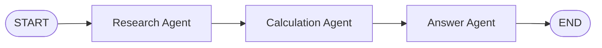

このChapterでは理解を優先するため、

```text
Research
   ↓
Calculation
   ↓
Answer
```

という**固定された順番**で処理します。

次のChapter 9では、この固定ルートをやめて、

```text
次はどのAgentを実行する？
```

を動的に判断するOrchestratorへ発展させます。

---

### このChapterで「Agent」と呼んでいるもの

ここで1つ、Chapter 6との違いを整理します。

Chapter 6では、LLMがToolを選びながら処理を進めるAgentを作りました。一方、このChapterの `research_agent()`、`calculation_agent()`、`answer_agent()` は、**Agentの役割を理解するために単純なPython関数として実装したLangGraphのNode**です。

```text
Chapter 6
LLM + Tool + 実行制御
        ↓
      Agent

Chapter 8
役割ごとのPython関数
        ↓
LangGraphのNodeとしてAgent役を表現
```

つまり、このChapterでは「複数の役割に処理を分け、Stateを介して連携する」というMulti Agentの**構造**を学ぶことを優先しています。

Research Agentなどの名前は役割を表していますが、この時点では各NodeがLLMによって自律的に判断するわけではありません。Chapter 9では、Toolを利用するLLM Agentを組み込み、より実際のAI Agentに近い構成へ発展させます。

---

## 4. Agent間で情報を共有する

Multi Agentでは、Agent同士で情報を引き継ぐ必要があります。

例えばResearch Agentが、

```text
交通費: 20,000円
ホテル代: 18,000円
```

という情報を取得したとします。

Calculation Agentは、この情報を使って、

```text
20,000 + 18,000
```

を計算する必要があります。

そこでChapter 7で学んだ **State** を使います。

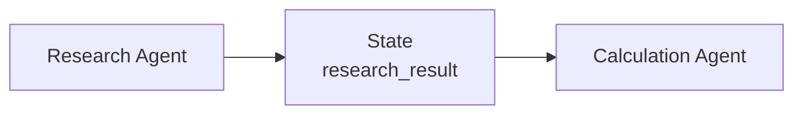

Research AgentがStateへ結果を書きます。

```text
State

research_result:
  交通費: 20,000円
  ホテル代: 18,000円
```

Calculation AgentはStateからその情報を読み、

```text
38,000円
```

という計算結果を書き込みます。

```text
State

research_result:
  交通費: 20,000円
  ホテル代: 18,000円

calculation_result:
  合計: 38,000円
```

Answer Agentは両方の情報を使って最終回答を作ります。

つまり、基本的な流れは、

```text
Agent
 ↓
Stateを更新
 ↓
次のAgent
 ↓
Stateを読む
```

です。

Stateを、**Agent間で共有するデータ**と考えると分かりやすくなります。

---

## 5. Stateを設計する

Chapter 8では、次のディレクトリ構成を使用します。

```text
examples/
└── chapter08_multi_agent/
    ├── README.md
    ├── main.py
    ├── graph.py
    ├── state.py
    │
    └── agents/
        ├── __init__.py
        ├── research.py
        ├── calculation.py
        └── answer.py
```

`state.py`を作ります。

```python
from typing import TypedDict


class AgentState(TypedDict):
    user_request: str
    research_result: str
    calculation_result: str
    final_answer: str
```

Stateには次の情報を保持します。

| 項目 | 内容 |
| --- | --- |
| `user_request` | ユーザーの依頼 |
| `research_result` | Research Agentの結果 |
| `calculation_result` | Calculation Agentの結果 |
| `final_answer` | Answer Agentの結果 |

図にすると、

```text
AgentState
│
├── user_request
├── research_result
├── calculation_result
└── final_answer
```

です。

---

## 6. Research Agentを作る

最初にResearch Agentを作ります。

`agents/research.py`

```python
def research_agent(state):
    user_request = state["user_request"]

    print(f"Research Agent: {user_request}")

    return {
        "research_result": (
            "交通費は20,000円、"
            "ホテル代は18,000円です。"
        )
    }
```

Research Agentは、

```text
user_request
```

を読み、

```text
research_result
```

を書き込みます。

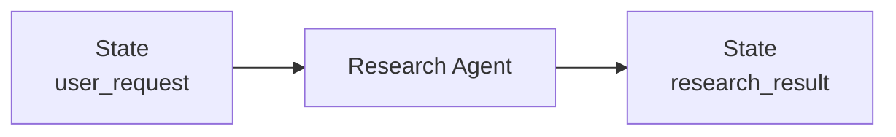

今回はMulti Agentの構造を理解することが目的なので、調査結果は固定値にしています。

実際のシステムでは、

```text
Research Agent
      │
      ├── Web Search Tool
      ├── Database Tool
      └── API Tool
```

のようにToolを持たせることができます。

---

## 7. Calculation Agentを作る

次にCalculation Agentを作ります。

`agents/calculation.py`

```python
def calculation_agent(state):
    research_result = state["research_result"]

    print(f"Calculation Agent: {research_result}")

    return {
        "calculation_result": "合計費用は38,000円です。"
    }
```

Calculation Agentは、

```text
research_result
```

を読み、

```text
calculation_result
```

を書き込みます。

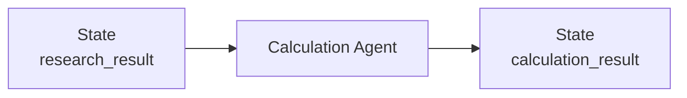

実際のシステムでは、

```text
Calculation Agent
       │
       ▼
Calculator Tool
```

のように計算Toolを利用する構成にもできます。

---

## 8. Answer Agentを作る

最後にAnswer Agentを作ります。

`agents/answer.py`

```python
def answer_agent(state):
    research_result = state["research_result"]
    calculation_result = state["calculation_result"]

    final_answer = (
        f"{research_result}\n"
        f"{calculation_result}"
    )

    return {
        "final_answer": final_answer
    }
```

Answer Agentは、

```text
research_result

+

calculation_result
```

を読み、

```text
final_answer
```

を作ります。

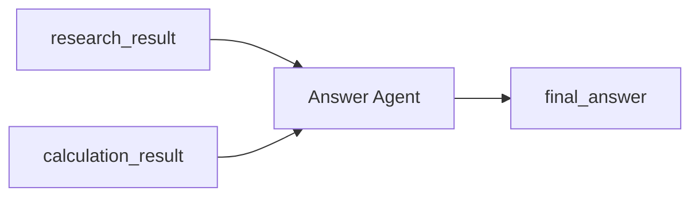

ここまでの役割を整理すると、

| Agent | 読み取るState | 更新するState |
| --- | --- | --- |
| Research | `user_request` | `research_result` |
| Calculation | `research_result` | `calculation_result` |
| Answer | `research_result`, `calculation_result` | `final_answer` |

Multi Agentを設計するときは、

> **各Agentが何を読み、何を書くのか**

を明確にすることが重要です。

---

## 9. AgentをLangGraphで接続する

Chapter 7では、

```text
Node = 処理
```

と学びました。

今回作った3つのAgentも、NodeとしてGraphへ登録します。

`graph.py`

```python
from langgraph.graph import StateGraph, START, END

from state import AgentState

from agents.research import research_agent
from agents.calculation import calculation_agent
from agents.answer import answer_agent


builder = StateGraph(AgentState)


builder.add_node(
    "research",
    research_agent
)

builder.add_node(
    "calculation",
    calculation_agent
)

builder.add_node(
    "answer",
    answer_agent
)
```

次にEdgeを追加します。

```python
builder.add_edge(
    START,
    "research"
)

builder.add_edge(
    "research",
    "calculation"
)

builder.add_edge(
    "calculation",
    "answer"
)

builder.add_edge(
    "answer",
    END
)
```

最後にGraphを完成させます。

```python
graph = builder.compile()
```

作成したGraphは、

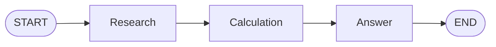

となります。

---

## 10. Graph全体を確認する

`graph.py`全体は次のようになります。

```python
from langgraph.graph import StateGraph, START, END

from state import AgentState

from agents.research import research_agent
from agents.calculation import calculation_agent
from agents.answer import answer_agent


builder = StateGraph(AgentState)


builder.add_node(
    "research",
    research_agent
)

builder.add_node(
    "calculation",
    calculation_agent
)

builder.add_node(
    "answer",
    answer_agent
)


builder.add_edge(
    START,
    "research"
)

builder.add_edge(
    "research",
    "calculation"
)

builder.add_edge(
    "calculation",
    "answer"
)

builder.add_edge(
    "answer",
    END
)


graph = builder.compile()
```

コードは長く見えますが、やっていることは4つだけです。

```text
① Stateを決める

② AgentをNodeとして登録する

③ EdgeでAgentを接続する

④ Graphをcompileする
```

---

## 11. Multi Agentを実行する

`main.py`を作ります。

```python
from graph import graph


result = graph.invoke(
    {
        "user_request": (
            "東京から大阪へ2泊3日で旅行したいです。"
            "予算は5万円です。"
        ),
        "research_result": "",
        "calculation_result": "",
        "final_answer": ""
    }
)


print(result["final_answer"])
```

実行します。

```bash
python examples/chapter08_multi_agent/main.py
```

例えば、

```text
交通費は20,000円、ホテル代は18,000円です。
合計費用は38,000円です。
```

と表示されます。

内部では、Stateが次のように変化しています。

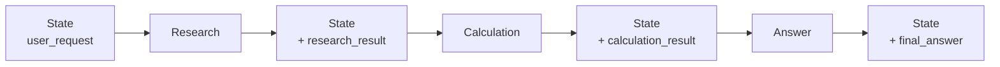

つまり、

```text
Research Agent
      ↓
research_resultを追加
      ↓
Calculation Agent
      ↓
calculation_resultを追加
      ↓
Answer Agent
      ↓
final_answerを追加
```

という処理です。

---

## 12. AgentごとにToolを持たせる

今回のコードでは、Multi Agentの構造を理解するために処理をシンプルにしています。

実際には、Chapter 6で学んだAgentのように、それぞれのAgentへToolを持たせることができます。

例えば、

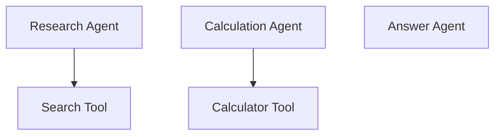

構成としては、

```text
Research Agent
 │
 └── Search Tool


Calculation Agent
 │
 └── Calculator Tool


Answer Agent
 │
 └── 最終回答を作る
```

となります。

Agentごとに必要なToolだけを持たせることで、役割を明確にできます。

ただし、**何でもMulti Agentにすればよいわけではありません。**

例えば、

```text
Agent
 │
 ├── add
 └── multiply
```

程度の小さな処理なら、単一Agentで十分です。

一方、

```text
調査
計算
回答作成
```

のように責務が明確に異なる場合は、Multi Agentを検討できます。

目安としては、

| 状況 | 構成 |
| --- | --- |
| 処理が単純 | Single Agent |
| 1つの役割で説明できる | Single Agent |
| 役割が明確に異なる | Multi Agentを検討 |
| Agentごとに異なるToolが必要 | Multi Agentを検討 |
| Agentごとに異なる指示が必要 | Multi Agentを検討 |

> **役割を分ける意味があるときにAgentを分ける**

と覚えておきましょう。

---

## 13. 演習

### 演習1：Agentの役割を確認する

今回作った3つのAgentについて、

```text
何を読む？

何をする？

何を書く？
```

を整理してください。

例えばResearch Agentなら、

```text
読む:
user_request

処理:
情報を調査する

書く:
research_result
```

となります。

---

### 演習2：Review Agentを追加する

余裕があれば、

```text
Review Agent
```

を追加してみましょう。

役割は、

> **Answer Agentが作った回答をレビューする**

です。

Graphを、

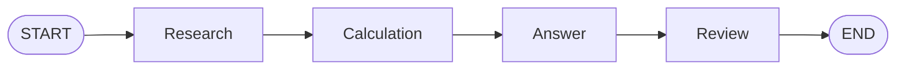

へ変更します。

Stateにも、

```python
review_result: str
```

を追加します。

Review Agentでは、

```text
final_answerを読む
        ↓
レビューする
        ↓
review_resultを書く
```

という処理を実装してみましょう。

---

## 14. まとめ

このChapterでは、**Multi Agent** の基本を学びました。

Multi Agentとは、

> **複数のAgentに役割を分けて処理する構成**

です。

今回作った構成は、


でした。

重要なポイントは3つです。

| ポイント | 内容 |
| --- | --- |
| 役割分担 | Agentごとに担当を分ける |
| State | Agent間で情報を共有する |
| Graph | Agentの実行順序を定義する |

処理としては、

```text
Research Agent
      ↓
State更新
      ↓
Calculation Agent
      ↓
State更新
      ↓
Answer Agent
```

と進みます。

そして、Multi Agentは多ければよいわけではありません。

```text
1つのAgentで十分
        ↓
Single Agent


役割を分ける意味がある
        ↓
Multi Agent
```

という基準で考えます。

---

# 次のChapter

**Chapter 9: Orchestrator構成を作る**

Chapter 8では、

```text
Research
   ↓
Calculation
   ↓
Answer
```

という**固定された順番**でAgentを実行しました。

しかし、

```text
100と200を足してください。
```

という質問ならResearch Agentは必要ありません。

そこで次のChapterでは、

```text
次に誰へ仕事を任せる？
```

を判断する **Orchestrator** を追加します。

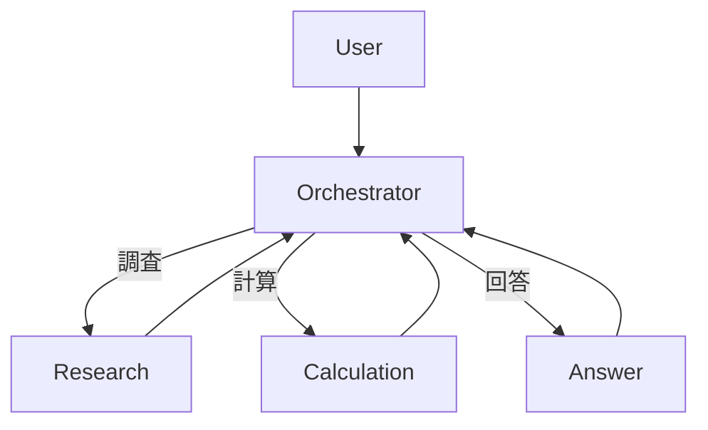

Chapter 8の、

```text
固定されたMulti Agent
```

から、

```text
Orchestratorが動的に担当を決めるMulti Agent
```

へ発展させていきます。