# Chapter 9: Orchestrator構成を作る

## この章で学ぶこと

この章では、複数のAgentへ仕事を振り分ける **Orchestrator** を作ります。

この章を読み終えると、以下のことができるようになります。

- Orchestratorの役割を説明できる
- ユーザーの依頼によって実行するAgentを動的に変更できる
- Research、Calculation、Answer Agentの役割を理解する
- Stateを使ってAgent間で情報を共有できる
- Tool Callingを利用するAgentをMulti Agent構成へ組み込める
- Conditional Edgeを使って処理を動的に分岐できる

このChapterは、これまで学習してきた内容の集大成です。

```text
LLM
 ↓
Tool
 ↓
Tool Calling
 ↓
Agent
 ↓
LangGraph
 ↓
Multi Agent
 ↓
Orchestrator
```

---

## 1. Chapter 8の問題点

Chapter 8では、複数のAgentに役割を分けました。

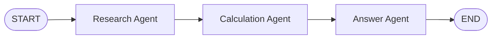

それぞれの役割は明確です。

| Agent | 役割 |
| --- | --- |
| Research Agent | 情報を調査する |
| Calculation Agent | 数値を計算する |
| Answer Agent | 最終回答を作る |

しかし、このGraphには問題があります。

**どんな依頼でも、すべてのAgentを順番に実行してしまいます。**

例えば、

```text
100と200を足してください。
```

という質問ならResearch Agentは必要ありません。

逆に、

```text
東京から大阪への交通手段を調べてください。
```

ならCalculation Agentは必要ないかもしれません。

そこでChapter 9では、

> **ユーザーの依頼や現在の処理状況によって、次に実行するAgentを動的に決める**

構成へ変更します。

---

## 2. Orchestratorとは

**Orchestrator** は、

> **次にどのAgentへ仕事を任せるかを判断し、全体の処理を制御するAgent**

です。

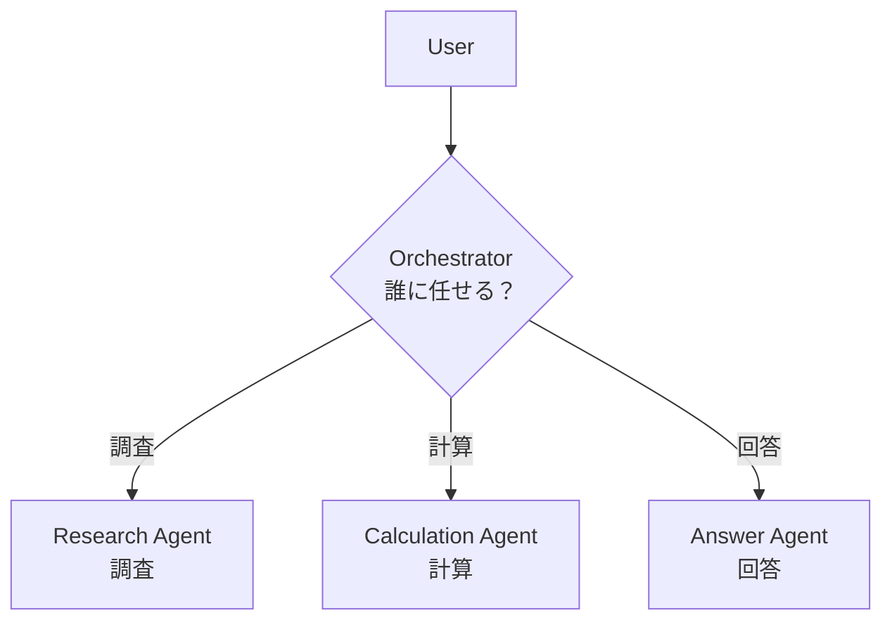

重要なのは、**Orchestrator自身が調査や計算をするわけではない**ことです。

役割を整理すると、

| Agent | 責務 |
| --- | --- |
| Orchestrator | 次に実行するAgentを決める |
| Research Agent | 調査する |
| Calculation Agent | 計算する |
| Answer Agent | 最終回答を作る |

チームに例えるなら、

```text
Orchestrator
= チームリーダー

Research Agent
= 調査担当

Calculation Agent
= 計算担当

Answer Agent
= 回答担当
```

という関係です。

---

## 3. 今回作るシステム

今回作るGraphは次の構成です。

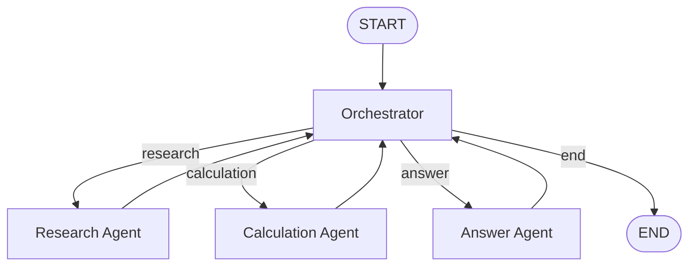

Chapter 8との大きな違いは、

```text
Research
   ↓
Calculation
   ↓
Answer
```

という固定ルートではないことです。

処理が終わるたびにOrchestratorへ戻ります。

```text
Orchestrator
     ↓
Agent
     ↓
State更新
     ↓
Orchestrator
     ↓
次のAgent
```

そしてOrchestratorが、

```text
次は誰に任せる？
```

を毎回判断します。

---

## 4. Orchestratorの処理フロー

Orchestratorは、次の4つから処理を選択します。

| route | 処理 |
| --- | --- |
| `research` | Research Agentへ任せる |
| `calculation` | Calculation Agentへ任せる |
| `answer` | Answer Agentへ任せる |
| `end` | 処理を終了する |

例えば、

```text
東京から大阪への交通手段を調べてください。
```

なら、

```text
route = research
```

と判断できます。

一方、

```text
100と200を足してください。
```

なら、

```text
route = calculation
```

です。

処理結果が揃えば、

```text
route = answer
```

最終回答まで完成すれば、

```text
route = end
```

となります。


この`route`が、動的なAgent振り分けの中心になります。

---

## 5. Stateを設計する

今回のディレクトリ構成は次のようにします。

```text
examples/
└── chapter09_orchestrator/
    ├── README.md
    ├── main.py
    ├── graph.py
    ├── state.py
    │
    ├── agents/
    │   ├── __init__.py
    │   ├── orchestrator.py
    │   ├── research.py
    │   ├── calculation.py
    │   └── answer.py
    │
    └── tools/
        ├── __init__.py
        ├── calculator.py
        └── search.py
```

`state.py`を作ります。

```python
from typing import TypedDict


class AgentState(TypedDict):
    user_request: str
    research_result: str
    calculation_result: str
    final_answer: str
    route: str
```

それぞれの役割は次の通りです。

| State | 内容 |
| --- | --- |
| `user_request` | ユーザーの依頼 |
| `research_result` | 調査結果 |
| `calculation_result` | 計算結果 |
| `final_answer` | 最終回答 |
| `route` | 次に実行するAgent |

特に重要なのが、

```text
route
```

です。

Orchestratorが`route`を更新し、LangGraphがその値を見て次のNodeを決めます。

```text
Orchestrator
     ↓
route = "research"
     ↓
LangGraph
     ↓
Research Agent
```

また、Stateを見ることで処理の進捗も分かります。

```text
research_result = ""
→ まだ調査していない

research_result != ""
→ 調査済み


calculation_result = ""
→ まだ計算していない

calculation_result != ""
→ 計算済み


final_answer != ""
→ 最終回答完成
```

つまりOrchestratorは、

```text
ユーザーの依頼

+

現在のState
```

を見て次の処理を判断します。

---

## 6. Orchestratorを作る

`agents/orchestrator.py`を作ります。

まず、Orchestratorの出力形式を定義します。

```python
from typing import Literal

from pydantic import BaseModel


class RouteDecision(BaseModel):
    route: Literal[
        "research",
        "calculation",
        "answer",
        "end"
    ]
```

Orchestratorには自由な文章ではなく、

```text
research
calculation
answer
end
```

のどれかを選んでもらいます。

次にLLMを準備します。

```python
from langchain_openai import ChatOpenAI


llm = ChatOpenAI(
    model="gpt-5.5"
)


router_llm = llm.with_structured_output(
    RouteDecision
)
```

Orchestrator本体を作ります。

```python
def orchestrator_agent(state):
    prompt = f"""
あなたは複数のAgentへ仕事を振り分けるOrchestratorです。

ユーザーの依頼:
{state["user_request"]}

調査結果:
{state["research_result"]}

計算結果:
{state["calculation_result"]}

最終回答:
{state["final_answer"]}

次に実行するAgentを選択してください。

research:
調査が必要な場合

calculation:
計算が必要な場合

answer:
必要な情報が揃っていて回答を作る場合

end:
最終回答が完成している場合
"""

    decision = router_llm.invoke(prompt)

    print(f"Orchestrator -> {decision.route}")

    return {
        "route": decision.route
    }
```

Orchestratorがやっていることはシンプルです。

```text
Stateを見る
    ↓
LLMで判断する
    ↓
routeを更新する
```

**調査や計算そのものは行いません。**

---

## 7. Research Agentを作る

Research Agentは情報を調査します。

今回はChapter 5で学んだ **Tool Calling** を組み込みます。

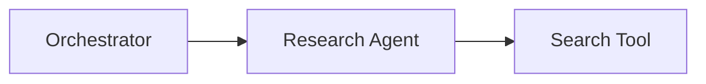

まず、`tools/search.py`にSearch Toolを作ります。

```python
from langchain_core.tools import tool


@tool
def search(query: str) -> str:
    """指定された内容について情報を検索します。"""

    return (
        f"{query}について調査しました。"
        "東京から大阪へは新幹線で移動できます。"
    )
```

今回は構成の理解を優先するため、検索結果は固定値にしています。

次に、`agents/research.py`を作ります。

```python
from langchain.agents import create_agent
from langchain_openai import ChatOpenAI

from tools.search import search


llm = ChatOpenAI(
    model="gpt-5.5"
)


research_agent_executor = create_agent(
    model=llm,
    tools=[search]
)


def research_agent(state):
    result = research_agent_executor.invoke(
        {
            "messages": [
                {
                    "role": "user",
                    "content": state["user_request"]
                }
            ]
        }
    )

    return {
        "research_result": result["messages"][-1].content
    }
```

処理は、

```text
Orchestrator
      ↓
Research Agent
      ↓
Tool Calling
      ↓
Search Tool
      ↓
research_result
```

となります。

---

## 8. Calculation Agentを作る

Calculation Agentは計算を担当します。

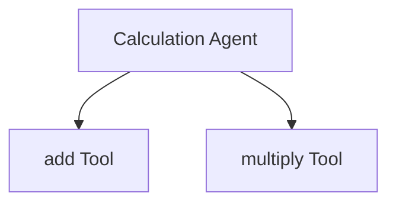

`tools/calculator.py`

```python
from langchain_core.tools import tool


@tool
def add(a: int, b: int) -> int:
    """2つの整数を足し算します。"""
    return a + b


@tool
def multiply(a: int, b: int) -> int:
    """2つの整数を掛け算します。"""
    return a * b
```

`agents/calculation.py`

```python
from langchain.agents import create_agent
from langchain_openai import ChatOpenAI

from tools.calculator import add, multiply


llm = ChatOpenAI(
    model="gpt-5.5"
)


calculation_agent_executor = create_agent(
    model=llm,
    tools=[
        add,
        multiply
    ]
)


def calculation_agent(state):
    request = f"""
ユーザーの依頼:
{state["user_request"]}

調査結果:
{state["research_result"]}

必要な計算を行ってください。
"""

    result = calculation_agent_executor.invoke(
        {
            "messages": [
                {
                    "role": "user",
                    "content": request
                }
            ]
        }
    )

    return {
        "calculation_result": result["messages"][-1].content
    }
```

Calculation Agentも、

```text
LLM
 ↓
Tool Calling
 ↓
Calculator Tool
```

というChapter 6で学んだAgent構成になっています。

---

## 9. Answer Agentを作る

Answer Agentは、集まった情報から最終回答を作ります。

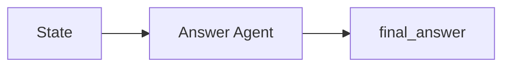

`agents/answer.py`

```python
from langchain_openai import ChatOpenAI


llm = ChatOpenAI(
    model="gpt-5.5"
)


def answer_agent(state):
    prompt = f"""
ユーザーの依頼:
{state["user_request"]}

調査結果:
{state["research_result"]}

計算結果:
{state["calculation_result"]}

これらの情報を使って、
ユーザーへの最終回答を作成してください。
"""

    response = llm.invoke(prompt)

    return {
        "final_answer": response.content
    }
```

これで4つのAgentが揃いました。

| Agent | 役割 | Tool |
| --- | --- | --- |
| Orchestrator | 振り分け | なし |
| Research Agent | 調査 | Search |
| Calculation Agent | 計算 | add / multiply |
| Answer Agent | 回答作成 | なし |

---

## 10. Conditional Edgeで動的に振り分ける

次に、Orchestratorの判断をLangGraphの分岐へ接続します。

まず、

```python
def route_next(state):
    return state["route"]
```

という関数を作ります。

そしてConditional Edgeを定義します。

```python
builder.add_conditional_edges(
    "orchestrator",
    route_next,
    {
        "research": "research",
        "calculation": "calculation",
        "answer": "answer",
        "end": END
    }
)
```

これによって、

```text
route = research
      ↓
Research Agent


route = calculation
      ↓
Calculation Agent


route = answer
      ↓
Answer Agent


route = end
      ↓
END
```

と分岐します。

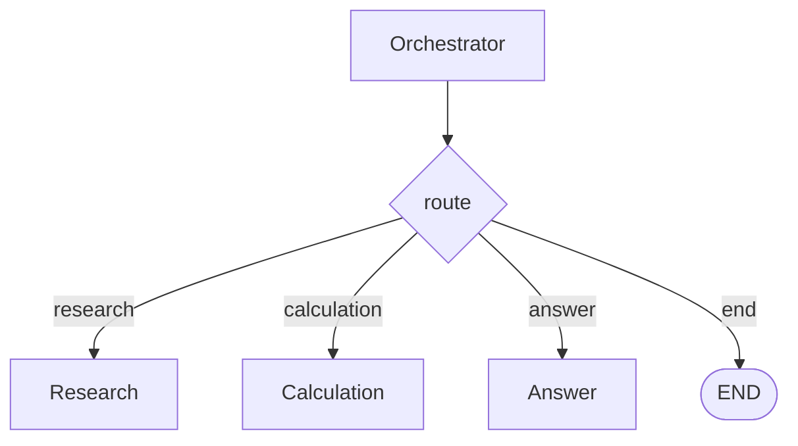

ここが、**Orchestratorが動的に担当を決める仕組みの中心**です。

---

## 11. Graph全体を作る

`graph.py`を作ります。

```python
from langgraph.graph import StateGraph, START, END

from state import AgentState

from agents.orchestrator import orchestrator_agent
from agents.research import research_agent
from agents.calculation import calculation_agent
from agents.answer import answer_agent


def route_next(state):
    return state["route"]


builder = StateGraph(AgentState)


builder.add_node(
    "orchestrator",
    orchestrator_agent
)

builder.add_node(
    "research",
    research_agent
)

builder.add_node(
    "calculation",
    calculation_agent
)

builder.add_node(
    "answer",
    answer_agent
)


builder.add_edge(
    START,
    "orchestrator"
)


builder.add_conditional_edges(
    "orchestrator",
    route_next,
    {
        "research": "research",
        "calculation": "calculation",
        "answer": "answer",
        "end": END
    }
)


builder.add_edge(
    "research",
    "orchestrator"
)

builder.add_edge(
    "calculation",
    "orchestrator"
)

builder.add_edge(
    "answer",
    "orchestrator"
)


graph = builder.compile()
```

コードを図にすると、次のGraphです。


コードが長く見えても、考え方は、

```text
① Nodeを登録

② START → Orchestrator

③ routeで分岐

④ Agentを実行

⑤ Orchestratorへ戻る
```

だけです。

---

## 12. 実行して処理ルートを確認する

`main.py`を作ります。

```python
from graph import graph


result = graph.invoke(
    {
        "user_request": (
            "東京から大阪への移動方法を調べて、"
            "交通費20,000円とホテル代18,000円の"
            "合計費用も教えてください。"
        ),
        "research_result": "",
        "calculation_result": "",
        "final_answer": "",
        "route": ""
    }
)


print(result["final_answer"])
```

実行します。

```bash
python examples/chapter09_orchestrator/main.py
```

今回の依頼には、

```text
調査
+
計算
+
回答
```

が必要です。

そのため、例えば次のようなルートになります。

```text
Orchestrator
    ↓
Research Agent
    ↓
Orchestrator
    ↓
Calculation Agent
    ↓
Orchestrator
    ↓
Answer Agent
    ↓
Orchestrator
    ↓
END
```

Sequence Diagramで見ると、

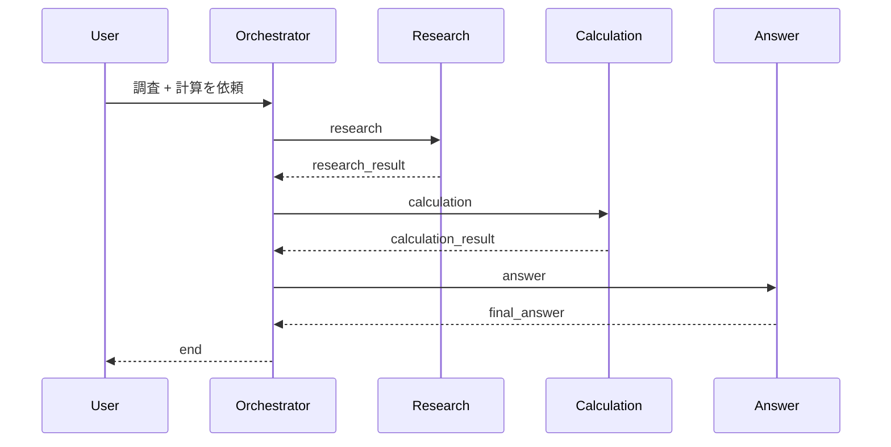

一方、

```text
100と200を足してください。
```

なら、Research Agentを使わず、

```text
Orchestrator
    ↓
Calculation
    ↓
Orchestrator
    ↓
Answer
    ↓
Orchestrator
    ↓
END
```

というルートを選択できます。

これがChapter 8との最大の違いです。

---

## 13. 演習

### 演習1：処理ルートを確認する

次の3つを入力してください。

#### 調査だけ必要

```text
東京から大阪への交通手段を調べてください。
```

#### 計算だけ必要

```text
100と200を足してください。
```

#### 調査と計算が必要

```text
東京から大阪への交通手段を調べて、
20,000円と18,000円の合計も教えてください。
```

ログから、

```text
Orchestrator -> research

Orchestrator -> calculation

Orchestrator -> answer

Orchestrator -> end
```

のどのルートが選択されたか確認してください。

---

### 演習2：新しいAgentを追加する

余裕があれば、

```text
Review Agent
```

を追加してみましょう。

役割は、

> **Answer Agentが作った回答をレビューする**

です。

Orchestratorの選択肢を、

```text
research
calculation
answer
review
end
```

へ変更します。

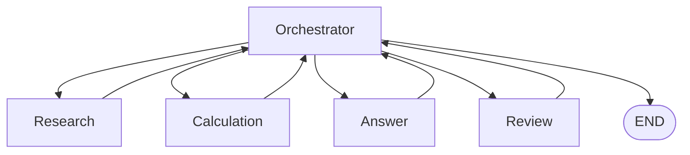

この演習ができれば、新しい役割を持つAgentをOrchestrator構成へ追加する基本を理解できています。

---

## 14. まとめ

このChapterでは、**Orchestrator構成**を作りました。

Chapter 8では、

```text
Research
 ↓
Calculation
 ↓
Answer
```

という固定されたMulti Agent構成でした。

Chapter 9では、

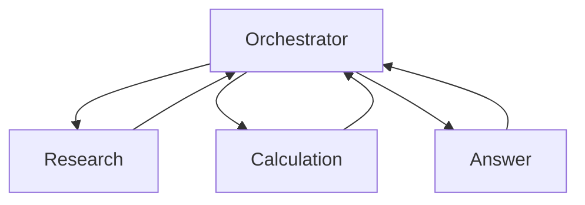

という構成に変更しました。

Orchestratorは、

```text
ユーザーの依頼

+

現在のState
```

を確認して、

```text
次に誰へ仕事を任せるか
```

を判断します。

覚えてほしいポイントは3つです。

| ポイント | 内容 |
| --- | --- |
| Orchestrator | 次のAgentを決める |
| Agent | 自分の担当処理を実行する |
| State | Agent間のデータと進捗を共有する |

そして、処理全体は、

```text
Orchestrator
     ↓
Agent
     ↓
State更新
     ↓
Orchestrator
```

というループで進みます。

最終回答が完成すると、

```text
route = end
```

となり処理を終了します。

---

# この教材で完成したAI Agent

Chapter 3からChapter 9までで、次の構成まで作りました。

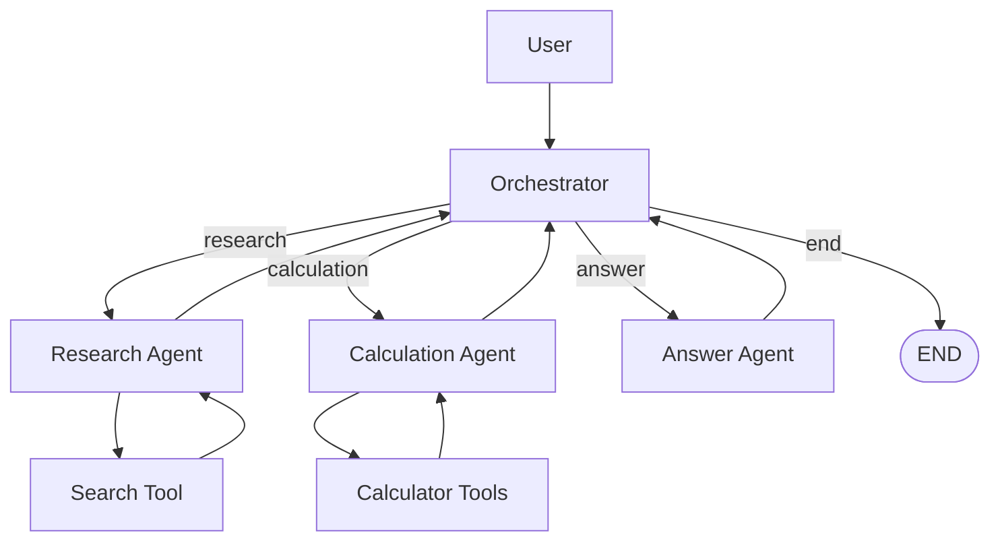

これまで学んだ内容を整理すると、

```text
Chapter 3
LLMを呼ぶ
     ↓
Chapter 4
Toolを作る
     ↓
Chapter 5
Tool Calling
     ↓
Chapter 6
Single Agent
     ↓
Chapter 7
LangGraph
     ↓
Chapter 8
Multi Agent
     ↓
Chapter 9
Orchestrator
```

最終的に、

```text
LLMによる判断

Toolによる実行

Agentによる自律的な処理

Stateによる情報共有

LangGraphによるフロー制御

Multi Agentによる役割分担

Orchestratorによる動的なタスク振り分け
```

までつながりました。

> **Orchestratorとは、すべての仕事をするAgentではありません。**

> **誰に仕事を任せるかを判断し、全体の処理を制御するAgentです。**

この考え方を理解できれば、この教材で目標としていたAI Agentの基本構成は完成です。